# 不疯狂动物城 Qt 前端使用说明书

> 适用代码：`不疯狂动物城/QtApp/` + `不疯狂动物城/src/`
> 界面技术：Qt Widgets，只使用 QWidget、QTabWidget、QGroupBox、QFormLayout、QLabel、QLineEdit、QComboBox、QSpinBox、QDateEdit、QCheckBox、QPushButton、QTableWidget、QTextEdit、QMessageBox 等基本控件。
> 数据目录：Qt 会把当前工作目录切到“文档/不疯狂动物城数据”，所有数据文件都在该目录下。

---

## 1. 前端概述

本前端把已有的五个业务模块串在一个窗口里：

| 模块 | 业务类 | 管理者功能 | 员工功能 |
| --- | --- | --- | --- |
| 动物园 | `zoo`、`animal` 及子类 | 添加、删除、改名、工资/账号、饲养、健康、记录、筛选、保存/加载 | 查看本人资料 |
| 考勤 | `Basic`、`FileOperation` | 查询、修改状态、删除修正、月度统计、保存/加载 | 签到、请假、查看本人考勤、月度统计 |
| 银行 | `BankService`、`BankAccount` | 开户、销户、存款、取款、转账、结息、账户/流水查询、保存/加载 | 查看本人账户、存款、取款、流水 |
| 工资 | `PayrollService`、`SalaryPolicy` | 汇总考勤、生成工资单、发放、保存/加载 | 查看本人工资单 |
| 食物 | `FoodPurchaseService`、`Food` | 食物目录、购买、购买记录、保存/加载 | 用本人账户购买、查看购买记录 |
| 数据导出 | `SqliteExporter` | 全部数据导出为 SQLite | — |

登录后按角色显示不同页面：

- **管理者**：动物园、考勤、银行、工资、食物五个标签页。
- **员工**：我的信息、我的考勤、我的账户、我的工资、购买食物五个标签页。

---

## 2. 运行环境与构建

### 2.1 环境

- Qt 6（本项目在 Qt 6.12.0 / Apple Silicon 上验证）
- CMake 3.16+
- C++17 编译器
- Qt Widgets 模块
- Qt SQL 模块（SQLite 驱动 QSQLITE，用于数据导出）

### 2.2 构建（命令行）

```bash
cd 不疯狂动物城/QtApp
mkdir -p build
cd build
cmake .. -DCMAKE_PREFIX_PATH=/path/to/Qt/6.12.0/macos
cmake --build . -j 6
./QtApp.app/Contents/MacOS/QtApp      # macOS
```

Windows 下用 Qt Creator 打开 `QtApp/CMakeLists.txt`，选择 Qt 6 Kit，直接“构建/运行”即可。

### 2.3 构建（Qt Creator）

1. 打开 Qt Creator，选择“文件 → 打开文件或项目”。
2. 选择 `不疯狂动物城/QtApp/CMakeLists.txt`。
3. 选择已安装的 Qt 6 Desktop Kit。
4. 点击“配置项目”，再点击“运行”。

---

## 3. 数据目录与文件

程序启动时会把当前目录切换到：

- macOS：`~/Documents/不疯狂动物城数据`
- Windows：`C:\Users\<用户名>\Documents\不疯狂动物城数据`

目录内文件：

| 文件 | 内容 | 对应类 |
| --- | --- | --- |
| `animals.txt` | 动物员工：类型、编号、姓名、翼展/食性、基本工资、银行账号 | `zoo::save/load` |
| `records.txt` | 饲养记录、健康记录 | `animal::saverecords`、`zoo::load` |
| `attendance.txt` | 考勤：年 月 日 员工编号 状态 | `FileOperation` |
| `payroll.txt` | 工资单 | `PayrollStorage` |
| `foods.txt` | 食物目录 | `FoodStorage` |
| `purchases.txt` | 食物购买记录 | `FoodStorage` |
| `data/accounts.csv` | 银行账户 | `BankStorage` |
| `data/transactions.csv` | 银行流水 | `BankStorage` |

窗口底部状态栏会显示当前数据目录。第一次运行没有文件是正常的，程序会按空数据启动。

---

## 4. 登录与角色

### 4.1 管理者

- 角色：管理者
- 账号：`admin`
- 密码：`123456`

管理者可以管理所有员工、所有账户、所有工资单和食物目录。

### 4.2 员工

- 角色：员工
- 账号：员工编号，例如 `A001`
- 密码：`123456`

员工必须先在“动物园管理”中存在，且最好已在“银行管理”中开户；否则购买食物和发工资会提示没有账户。

### 4.3 首次使用顺序

1. 管理者登录。
2. 在“动物园管理”添加动物员工，填写编号、姓名、翼展/食性，保存工资和账号（也可以先不填账号）。
3. 在“银行管理”给员工开户；开户成功后账号会自动绑定到该员工。
4. 在“考勤管理”录入考勤。
5. 在“工资管理”生成并发放工资单。
6. 在“食物管理”添加食物，再给员工购买。
7. 退出登录，用员工编号登录，查看自己的考勤、账户、工资和购买记录。

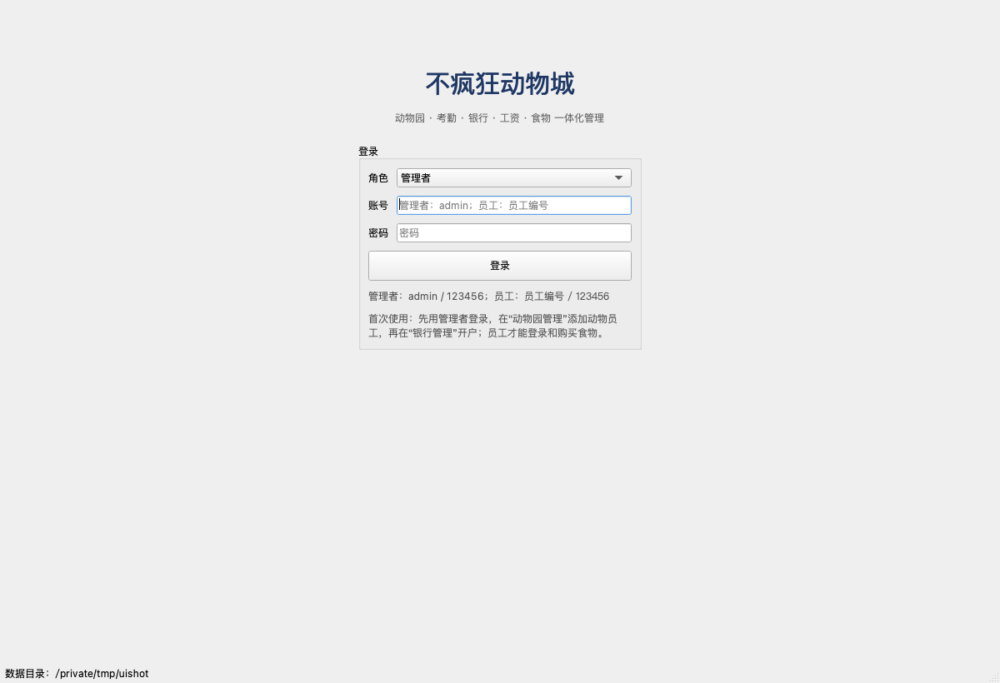

---

## 5. 管理者功能

### 5.1 动物园管理

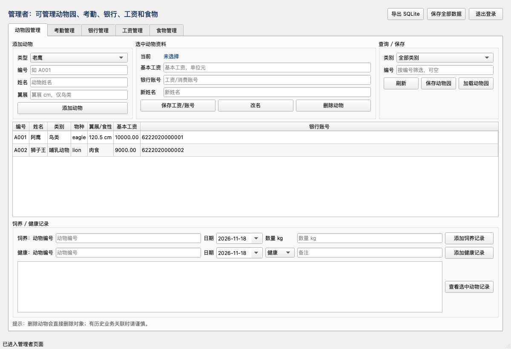

| 操作 | 位置 | 说明 |
| --- | --- | --- |
| 添加动物 | 左上“添加动物” | 类型、编号、姓名；鸟类还要翼展。编号不能重复 |
| 修改工资/账号 | 中上“选中动物资料” | 先在表格选中动物，填基本工资（元）和银行账号，点“保存工资/账号” |
| 改名 | 中上“选中动物资料” | 输入新姓名，点“改名” |
| 删除动物 | 中上“选中动物资料” | 删除前会确认；有历史业务关联时请谨慎 |
| 按类别/编号筛选 | 右上“查询/保存” | 类别选“全部/鸟类/哺乳动物”，编号可空 |
| 保存/加载 | 右上“查询/保存” | `animals.txt`、`records.txt` |
| 添加饲养记录 | 下方“饲养/健康记录” | 动物编号、日期、数量 kg |
| 添加健康记录 | 下方“饲养/健康记录” | 动物编号、日期、状态、备注 |
| 查看记录 | 下方“查看选中动物记录” | 文本区显示饲养和健康记录 |

说明：删除动物不会自动删除其考勤、账户和工资记录；演示时请先确认没有重要关联。

### 5.2 考勤管理

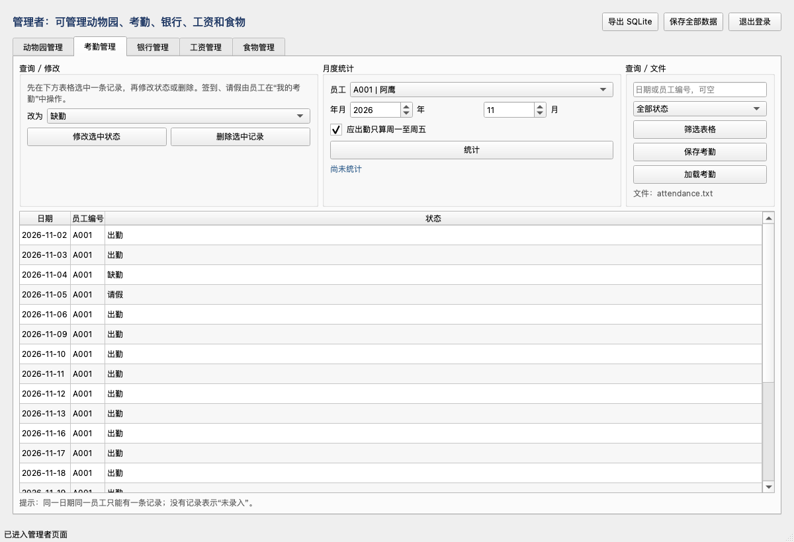

| 操作 | 位置 | 说明 |
| --- | --- | --- |
| 查询 | 右上 | 按日期/员工编号筛选，并可选择状态（全部/缺勤/出勤/请假） |
| 修改选中 | 左上 | 在表格选中一行，选择“改为”的状态，点“修改选中状态” |
| 删除选中 | 左上 | 在表格选中一行，确认后删除；用于纠正误记录 |
| 月度统计 | 中上 | 员工、年、月；可勾选“只算周一至周五”；显示应出勤、出勤、缺勤、请假、未录入 |
| 保存/加载 | 右上 | `attendance.txt` |

管理者不再直接“添加考勤”：签到、请假由员工在“我的考勤”中操作；管理者只负责查询和修改/删除修正。

“未录入”表示应出勤但当天没有记录，不能直接算作缺勤；工资计算时如果存在未录入天数，会拒绝生成工资单。

### 5.3 银行管理

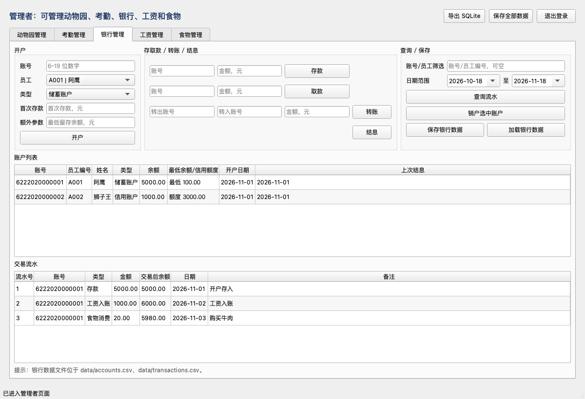

| 操作 | 位置 | 说明 |
| --- | --- | --- |
| 开户 | 左上 | 账号 6~19 位数字、员工、类型、首次存款、额外参数（最低余额/信用额度）；成功后自动绑定员工账号 |
| 存款/取款 | 中上 | 账号、金额 |
| 转账 | 中上 | 转出账号、转入账号、金额 |
| 结息 | 中上 | 按上次结息日期到今天计算；储蓄利息入账，信用利息计入欠款 |
| 查询账户 | 账户列表上方筛选 | 账号/员工编号/姓名任意包含即可 |
| 销户 | 右上 | 先选中账户；有欠款不能销户；销户后自动解绑员工账号 |
| 查询流水 | 右上 | 账号/员工筛选 + 日期范围 |
| 保存/加载 | 右上 | `data/accounts.csv`、`data/transactions.csv` |

账户类型：

- 储蓄账户：取款后不能低于最低留存余额；年利率 1.5%。
- 信用账户：可透支到信用额度；欠款日利率 0.05%。

### 5.4 工资管理

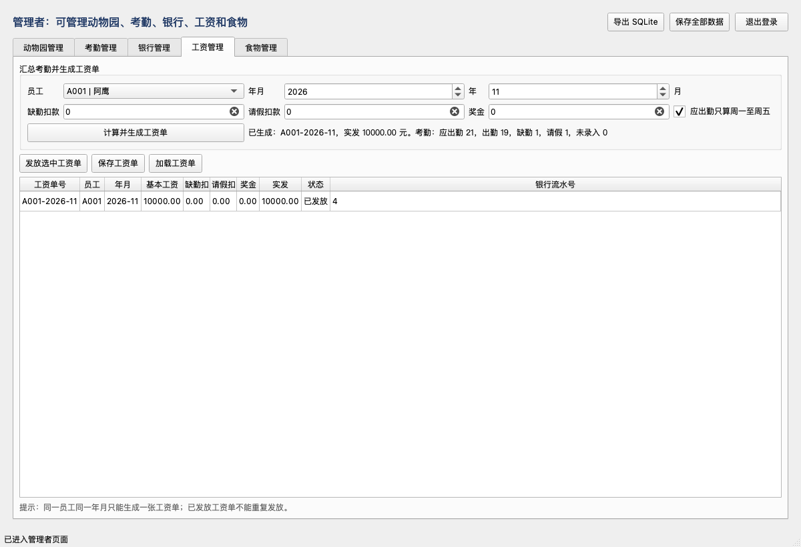

| 操作 | 位置 | 说明 |
| --- | --- | --- |
| 生成工资单 | 上方 | 员工、年、月、应出勤口径、缺勤/请假每天扣款、奖金；先汇总考勤，再计算并生成工资单 |
| 发放选中 | 表格上方 | 先选中一张“未发放”工资单，再点“发放选中工资单”；已发放不能重复发 |
| 保存/加载 | 表格上方 | `payroll.txt` |

工资公式：

```text
实发 = 基本工资 - 缺勤天数 × 缺勤日扣款 - 请假天数 × 请假日扣款 + 奖金
```

生成工资单前会检查：

- 员工编号与考勤统计一致；
- 出勤 + 缺勤 + 请假 + 未录入 = 应出勤；
- 没有未录入天数。

### 5.5 食物管理

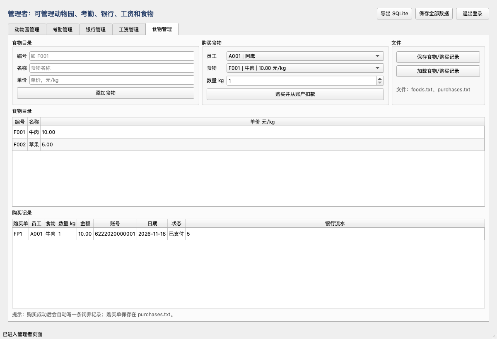

| 操作 | 位置 | 说明 |
| --- | --- | --- |
| 添加食物 | 左上 | 编号、名称、单价（元/kg）；编号不能重复 |
| 购买食物 | 中上 | 员工、食物、数量 kg；从员工绑定账户扣款 |
| 购买记录 | 下方 | 购买单号、员工、食物、数量、金额、账号、日期、状态、银行流水 |
| 保存/加载 | 右上 | `foods.txt`、`purchases.txt` |

购买成功后会自动：

- 在银行生成一条“食物消费”流水；
- 写一条 `FoodPurchaseRecord` 购买单；
- 写一条饲养记录（`records.txt`）。

前提：员工必须已经在“银行管理”开户并绑定账号。

---

## 6. 员工功能

### 6.1 我的信息

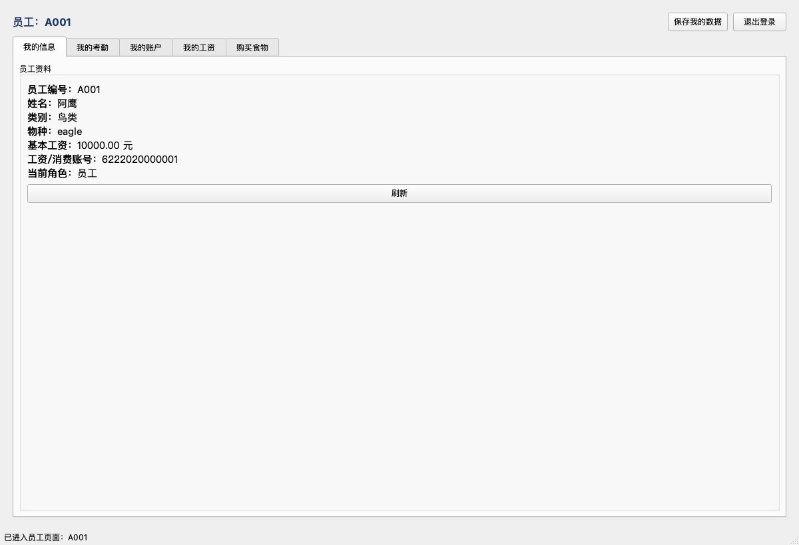

显示当前员工的编号、姓名、类别、物种、基本工资、工资/消费账号和角色。员工不能修改这些资料，修改由管理者完成。

### 6.2 我的考勤

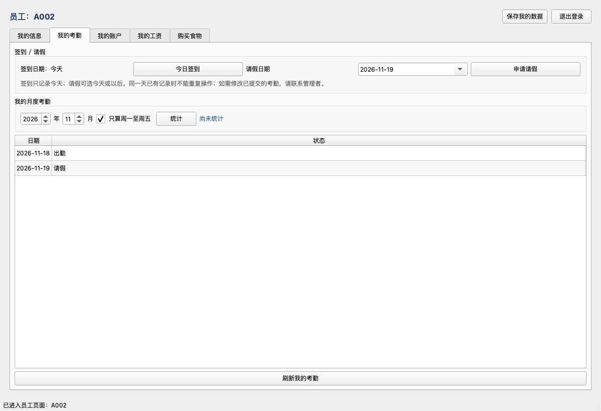

员工可以在这里完成：

- **今日签到**：只写今天一条“出勤”记录；今天已有记录时不能重复签到。
- **申请请假**：选择今天或以后的日期，写一条“请假”记录；同一天已有记录时不能重复操作。
- **我的考勤表**：显示本人所有考勤记录。
- **月度统计**：选择年月和“只算周一至周五”后统计应出勤、出勤、缺勤、请假、未录入。

签到/请假会立即写入 `attendance.txt`；如需修改已提交的记录，请联系管理者。

### 6.3 我的账户

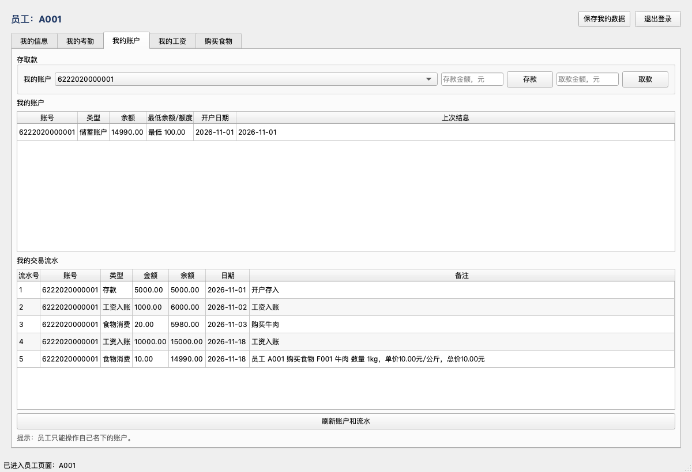

- 账户下拉框列出本人账户；
- 可以存款、取款；
- 下方显示本人账户和交易流水；
- 员工只能操作自己名下的账户。

### 6.4 我的工资

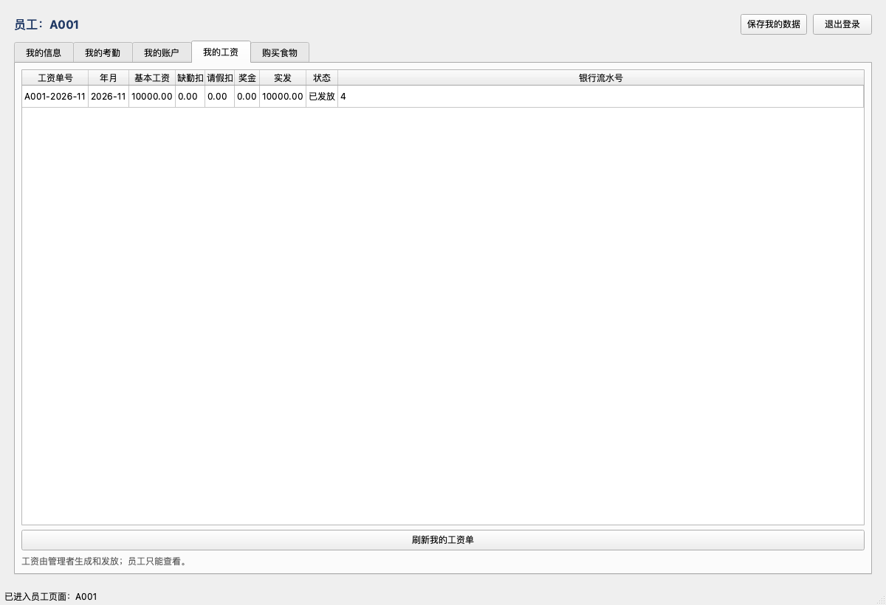

显示本人的工资单：工资单号、年月、基本工资、缺勤扣款、请假扣款、奖金、实发、状态、银行流水号。工资由管理者生成和发放，员工只读。

### 6.5 购买食物

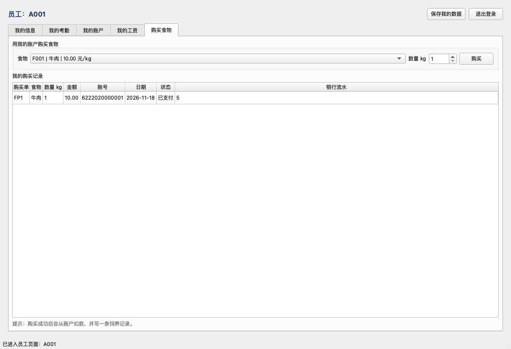

选择食物和数量 kg，点“购买”；从本人绑定账户扣款，并写购买记录和饲养记录。

---

## 7. 数据导出到 SQLite

管理者页面右上角有“导出 SQLite”按钮：把当前内存中的全部业务数据写成一个 `.db` 文件。

### 7.1 操作步骤

1. 管理者登录，先点“保存全部数据”（可选，但建议先把文本/CSV 数据落盘）。
2. 点右上角“导出 SQLite”。
3. 选择保存位置和文件名，例如 `不疯狂动物城导出.db`。
4. 成功后会提示数据库路径和表名；失败会提示具体 SQL 错误。

### 7.2 数据库表

| 表 | 内容 |
| --- | --- |
| `employees` | 动物员工：编号、姓名、类别、物种、翼展/食性、基本工资（分）、银行账号 |
| `feed_records` | 饲养记录：员工编号、日期、公斤数 |
| `health_records` | 健康记录：员工编号、日期、状态、备注 |
| `attendance` | 考勤：日期、员工编号、状态（0/1/2），主键为日期+员工 |
| `bank_accounts` | 银行账户：账号、户主、类型、余额、最低余额、信用额度、日期 |
| `transactions` | 银行流水：流水号、账号、类型、金额、交易后余额、日期、备注 |
| `payrolls` | 工资单：工资单号、员工、年月、各项金额、状态、流水号、考勤快照 |
| `foods` | 食物目录：编号、名称、单价（分/kg） |
| `food_purchases` | 食物购买记录：购买单、员工、食物、数量、金额、账号、日期、状态、流水号 |
| `export_info` | 导出时间、数据目录、格式版本、各表行数 |

所有金额字段都以“分”为单位（`INTEGER`），与源码中的 `Money` 一致；日期为 `YYYY-MM-DD` 文本。

### 7.3 验证导出结果

```bash
sqlite3 不疯狂动物城导出.db ".tables"
sqlite3 不疯狂动物城导出.db "select * from export_info;"
sqlite3 不疯狂动物城导出.db "select * from employees;"
```

也可以用 DB Browser for SQLite 打开查看。

> 导出是“当前内存快照”，不会自动保存文本/CSV 文件；重要数据请先点“保存全部数据”。
> 如果目标文件被其他程序占用，导出会失败并提示无法覆盖。

## 8. 保存、加载与退出

- 管理者/员工页面顶部都有“保存全部数据”，一次保存所有模块。
- 各标签页还有局部的“保存/加载”按钮，只操作该模块的文件。
- 退出登录不会丢数据；关闭窗口会自动保存全部模块。
- 如果保存失败，弹窗会提示检查数据目录是否可写。

---

## 9. Qt 代码结构与标注

```text
QtApp/
├── main.cpp            入口：设置数据目录、创建 QApplication/MainWindow
├── mainwindow.h        MainWindow 声明、页面控件指针、全部槽函数
├── mainwindow.cpp      窗口骨架、登录/登出、数据加载保存、通用刷新/工具
├── managerpage.cpp     管理者五个标签页及业务按钮
├── employeepage.cpp    员工五个标签页及业务按钮
└── mainwindow.ui       只保留 pageStack + 登录/管理者/员工三个空页面
```

代码里的注释标记：

| 标记 | 含义 |
| --- | --- |
| `[界面]` | 纯界面搭建、布局、控件 |
| `[功能]` | 按钮对应的业务操作 |
| `[刷新]` | 从业务对象重新读取数据填表 |
| `[校验]` | 界面层输入检查 |
| `[Qt 前端支持]` | 为界面补充的只读访问器、重载或小改动 |
| `[SQLite 导出]` | SQLite 建表、写入、事务和错误处理 |

业务层只增加了少量“界面支持”接口，例如：

- `zoo::getanimals()/clear()`：遍历和加载前清空；
- `Basic::dayCount()/dayAt()`、`changeRecord(Date, ID, newStatus)`：表格读取和不使用 `cin` 的修改；
- `BankService::getAccounts()/getTransactions()`：表格刷新；
- `animal::getfeedrecords()/gethealthrecords()`、`bird::getwinglength()`、`mammal::getdiettype()`：界面展示；
- `FoodPurchaseRecord` 与 `FoodPurchaseService` 的购买记录、`FoodStorage` 的购买记录读写：食物购买闭环；
- `Transaction::TX_FOOD_PURCHASE`：食物消费独立流水类型。

---

## 10. 演示流程（建议按顺序）

1. 启动程序，管理者登录 `admin / 123456`。
2. 动物园管理：添加 `A001 / 阿鹰 / 老鹰 / 翼展 120`，保存工资 `10000`。
3. 银行管理：给 `A001` 开储蓄账户 `6222020000001`，首次存款 `5000`，最低留存 `0`；账号自动绑定。
4. 退出管理者，员工登录 `A001 / 123456`；在“我的考勤”点“今日签到”，再选择日期“申请请假”。
5. 管理者登录，在“考勤管理”查询 `A001` 的记录并修改/删除修正；再在“工资管理”生成并发放工资单。
6. 食物管理：添加食物 `F001 / 牛肉 / 10 元/kg`；给 `A001` 购买 2 kg。
7. 动物园管理：查看 `A001` 的饲养记录，应出现一条 2 kg 的购买进食记录。
8. 管理者点“导出 SQLite”，保存 `不疯狂动物城导出.db`，用 DB Browser 或 `sqlite3` 查看表。
9. 退出登录，员工登录 `A001 / 123456`，查看我的信息、考勤、账户、工资、购买记录。

---

## 11. 常见问题

**Q1：员工登录提示“没有找到该员工”？**
先在管理者“动物园管理”添加动物员工；员工编号就是登录账号。

**Q2：购买食物提示“还没有绑定银行账号”？**
先在“银行管理”给该员工开户；开户成功后会自动把账号写回员工资料。

**Q3：生成工资单提示“考勤存在未录入天数”？**
在“考勤管理”把该员工该月应出勤日期补齐，或调整“只算周一至周五”的口径。

**Q4：发放工资提示“账号不属于当前员工”？**
检查员工资料里的银行账号是否与账户户主编号一致；在“动物园管理”重新保存账号，或在“银行管理”重新开户。

**Q5：数据保存在哪里？**
窗口底部状态栏显示数据目录；默认是“文档/不疯狂动物城数据”。备份时复制整个目录即可。

**Q6：为什么删除动物后账户还在？**
`zoo::removeanimal()` 目前只删除动物对象，不级联删除考勤/账户/工资；这是当前实现的限制，演示时请先确认关联数据。

**Q7：银行保存是原子操作吗？**
不是。`BankService::saveData()` 分别保存账户和流水，极端情况下可能只成功一个文件；重要演示前建议点“保存全部数据”并确认提示。

---

## 12. 当前限制

- 员工密码统一为 `123456`，没有实现用户表；管理者固定 `admin/123456`。
- 员工只能查看自己的工资单，不能自行发放；发放由管理者完成。
- 动物园删除不做关联保护；删除前请确认。
- 银行账户/流水分别保存，不是跨文件事务。
- 数据文件是文本/CSV，字段中不能包含分隔符（逗号/竖线/空格），演示时请使用简单名称。
- 考勤容量仍是 `Basic` 的固定数组：最多 366 个日期、每天 100 条。
