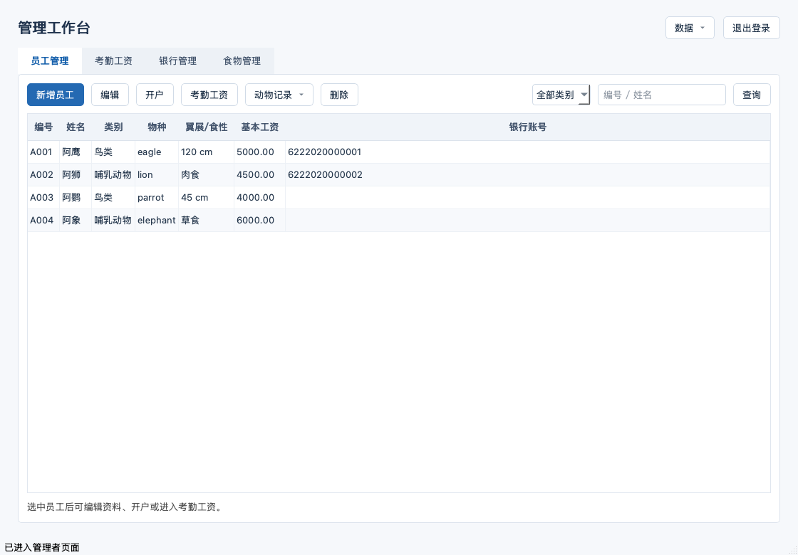
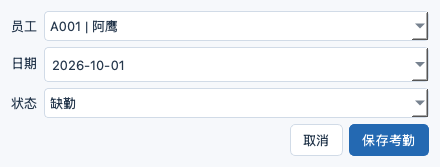
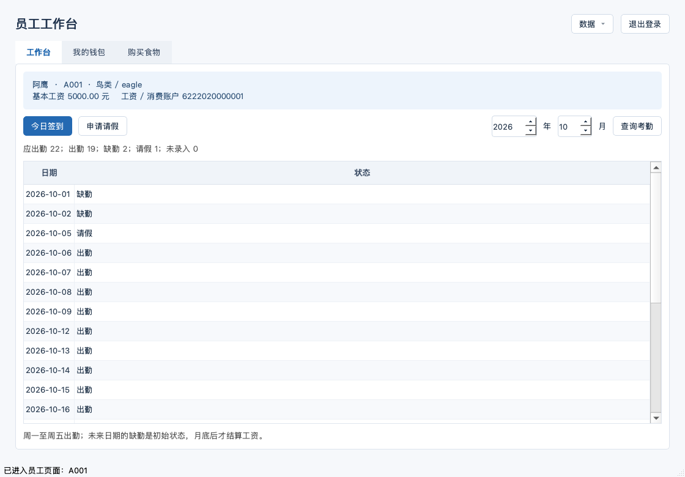
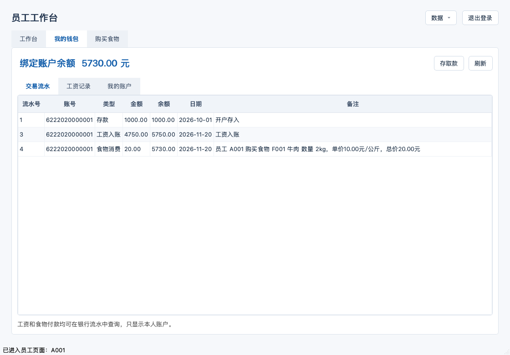

# 不疯狂动物城使用说明

本程序把动物员工、考勤、银行、工资和食物购买整合到一个 Qt 窗口。管理者负责资料、考勤设置和工资发放；员工负责本人签到、请假、账户操作和食物购买。数据保存为文本和 CSV 文件。

## 打开程序

1. 启动 Qt Creator，选择“文件 → 打开文件或项目”。
2. 打开项目中的 `QtApp/CMakeLists.txt`。
3. 选择已安装的 Qt 桌面套件，配置工程后点击绿色运行按钮。
4. 左侧展开 `QtApp` 目标可以查看源码。完整界面在运行后显示，`mainwindow.ui` 只保留三个身份页面容器。

工程使用 C++17、CMake 和 Qt Widgets。在本机验证的套件是 Qt 6.12 / Apple Silicon。

## 登录身份

| 身份 | 账号 | 密码 |
| --- | --- | --- |
| 管理者 | `admin` | `123456` |
| 员工 | 已创建的动物员工编号，例如 `A001` | `123456` |

先在登录页选择身份，再输入对应账号。员工编号与动物编号相同。首次使用没有员工时，先用管理者添加动物员工。

## 管理者界面



### 员工管理

- **新增员工**：填写物种、编号、姓名和基本工资；老鹰、鹦鹉还要填写翼展。
- **编辑**：先选中一行，在一个弹窗中修改姓名、基本工资和绑定账号。绑定账号必须属于该员工。
- **开户**：选中员工后点击，开户表单自动带入该员工；成功后自动绑定账号。
- **考勤工资**：选中员工后直接跳转到其考勤、工资页面。
- **动物记录**：菜单内登记饲养、登记健康、查看历史；这些记录独立于食物购买。
- **删除**：删除选中动物；已有银行流水、工资等历史记录不会自动删除。
- 右侧按类别、编号或姓名查询员工。

### 考勤工资

顶部员工、年、月由考勤和工资共同使用。选择“全部员工”可查看全体当月记录；生成工资时需要选择具体员工。



**设置考勤**：

1. 可以先选中表格中的记录，也可以直接点击“设置考勤”。
2. 在弹窗中选择员工、日期和状态：缺勤、出勤、请假。
3. 点击“保存考勤”。已有记录会被修改；没有记录时会补录。
4. 表格自动切换到这名员工和对应月份，记录立即保存。

**删除记录**用于移除误录入记录。对于应出勤日期，下次初始化或月度查询会补回默认缺勤；需要补录时可直接使用“设置考勤”。

**查询考勤**补齐所选月份的默认记录并统计。排班统一为周一至周五，周末记录可以保存，但不纳入这套月工资排班统计。

**生成和发放工资**：

1. 先开户、绑定账号、设置基本工资，核对考勤。
2. 选择已经结束的月份，点击“生成工资单”。
3. 在弹窗中填写每次缺勤扣款、每次请假扣款和奖金，金额单位元。
4. 在下方选中生成的工资单，点击“发放选中工资单”。
5. 工资存入绑定账户，工资单变为“已发放”，并显示对应银行流水号。

```text
实发工资 = 基本工资 − 缺勤天数 × 每次缺勤扣款 − 请假天数 × 每次请假扣款 + 奖金
```

同一员工同一年月不能重复生成工资单，已发放工资不能重复发放。工资单保存计算时的快照，后来更正考勤或调整工资不会自动重算历史工资。因此先核对考勤，再生成工资单；扣款和奖金应使实发金额为正，银行入账不接受零或负数存款。

### 银行管理

- **账户列表**：查看账号、员工、类型、余额、最低余额或信用额度。
- **开户**：储蓄账户填写最低留存余额，信用账户填写信用额度。
- **资金操作**：弹窗中办理存款、取款、转账；选中过账户时自动带入账号。
- **销户**：选中账户后确认，存在欠款时不能销户；员工对应绑定账号会解除。
- **结息**：使用银行原有的储蓄、信用账户计息规则。
- **交易流水**：通过账号、员工编号或姓名及日期范围查询。

### 食物管理

管理者维护食物目录并查询购买历史，不代员工购买。

- **添加食物**：填写编号、名称、每公斤单价。名称使用不带空格的文本，例如“牛肉”。
- **食物目录**：显示当前可购买的食品。
- **购买记录**：按员工编号、食物、日期、账号或银行流水号筛选；清空条件后查询全部。

## 员工界面



### 工作台

顶部显示本人资料。点击“今日签到”把今天的默认缺勤改为出勤；点击“申请请假”选择今天或以后的应出勤日期，将默认缺勤改为请假。已出勤或请假时不能重复提交；过去日期由管理者更正。

按年、月查询本人考勤。初始化只补缺少记录，不覆盖已经登记的出勤和请假。未来日期的“缺勤”是初始状态，整月工资在月份结束后结算。

### 我的钱包



顶部显示绑定账户余额。“存取款”弹窗提供本人账户、业务类型、金额三个输入。下方分别查看交易流水、工资记录和本人名下账户。

工资月份表示工资归属，银行交易日期表示实际入账日期，二者可以不同。未发放工资的流水号为0；成功发放后显示实际流水号。已销户账户不在员工当前账户列表中，其历史流水可由管理者按账号查询。

### 购买食物

选择食物、公斤数，点击“购买”。从本人绑定账户扣款，写入银行食物消费流水和购买快照。下方只显示本人购买记录。

购买不会自动增加饲养记录；饲养仍由管理者独立登记。

## 数据保存和目录

右上角“数据”菜单提供保存和数据位置查询；管理者还可以重新加载全部数据。退出登录和关闭窗口时也会保存。数据位置以“数据 → 查看数据位置”显示的路径为准。

默认目录为“文档/不疯狂动物城数据”。启动时传入 `--data-dir "目录路径"` 可使用独立目录，演示脚本使用此方式隔离数据。

| 文件 | 内容与格式 |
| --- | --- |
| `animals.txt` | 员工资料；鸟类 `物种|编号|姓名|翼展|工资分|账号`，哺乳类不含翼展列；空账号仍保留末尾竖线 |
| `records.txt` | `编号|feed|日期|公斤数`，或 `编号|health|日期|状态|备注` |
| `attendance.txt` | 每行 `年 月 日 员工编号 状态` |
| `data/accounts.csv` | 账号、员工编号、姓名、类型、余额分、最低余额分、信用额度分、开户日期、上次结息日期 |
| `data/transactions.csv` | 流水号、账号、类型、金额分、交易后余额分、日期、备注 |
| `payroll.txt` | 工资单及考勤快照，20个空格分隔字段 |
| `foods.txt` | 食物编号、名称、单价分，每行空格分隔 |
| `purchases.txt` | 购买快照，11个竖线分隔字段 |

所有界面金额显示元，文件中的金额保存为分。按当前文本格式输入字段，不在编号、名称中加入空格或分隔符。备份时复制整个数据目录，加载时从同一个目录恢复。

当前考勤容器累计最多366个不同日期，每天最多100名员工。容量不足会提示，不会把未登记的员工误报为休息日。

## 运行演示

macOS 可以直接双击项目的 `demo/启动演示.command`。它准备独立数据、编译程序并打开演示，不覆盖正式数据。

完整操作顺序、预期工资和余额见 [演示Demo](演示Demo.md)；各类功能和实现思路见 [类说明](类说明.md)。
