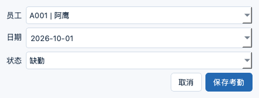
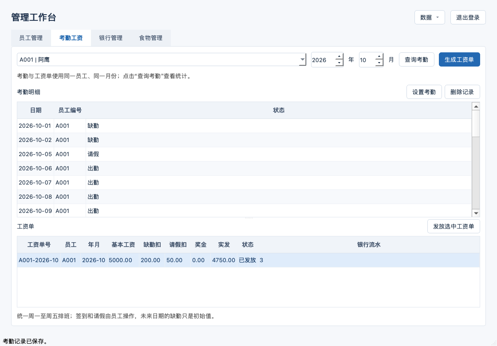
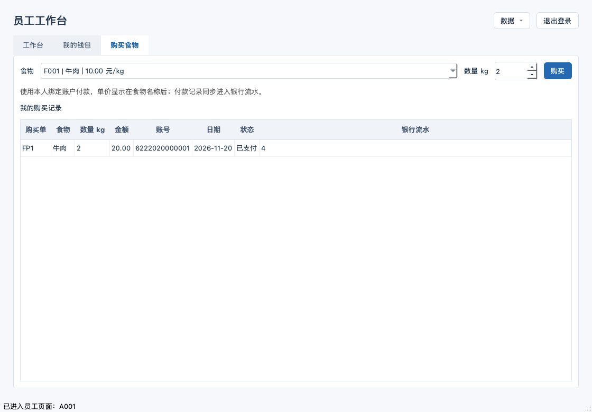
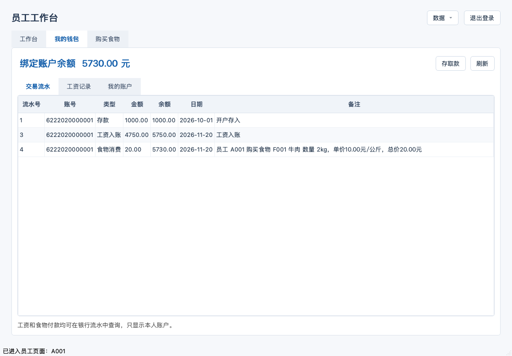
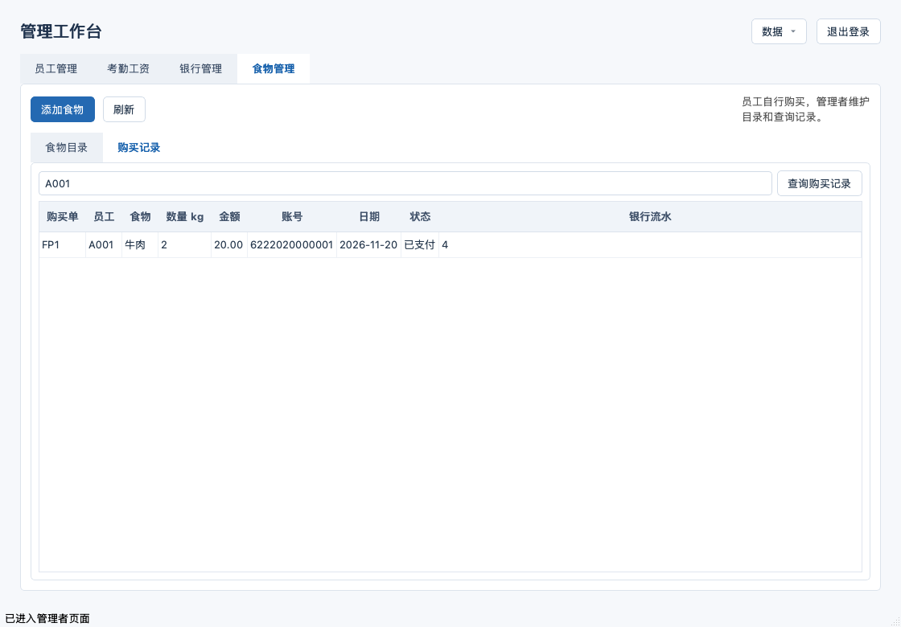

# 不疯狂动物城演示Demo

本 Demo 使用真实 Qt 程序和独立演示文件，串起“管理者设置考勤 → 统计工资 → 银行入账 → 员工购买食物 → 管理者查询”。每次通过启动脚本运行都会创建一个新的临时数据目录，不覆盖正式数据或上次演示。

## 启动方式

### macOS一键启动

双击 `不疯狂动物城/demo/启动演示.command`，等待编译，程序会自动打开。终端会打印数据目录、工资演示月份和预期金额。

脚本使用本机 CMake、Qt 安装和 Python 3，不下载软件。找不到 Qt 时，可以在终端指定安装位置，例如：

```sh
ZOO_QT_PREFIX="$HOME/Qt/6.12.0/macos" ./demo/启动演示.command
```

### 使用Qt Creator

在项目根目录执行，目标目录应为空：

```sh
python3 demo/准备演示数据.py --output /tmp/zoocity-demo-manual
```

在 Qt Creator 的“项目 → 运行 → 命令行参数”填写：

```text
--data-dir "/tmp/zoocity-demo-manual"
```

然后构建并运行。重复准备时换一个空目录；生成器会拒绝覆盖已有文件。恢复正式使用时清空运行参数。

## 演示数据

演示月份自动选择运行日之前的完整月份。2026年11月运行时，演示月份为2026年10月。具体年月和应出勤天数以终端输出或数据目录中的 `demo.json` 为准。

| 员工 | 物种 | 基本工资 | 初始账户 |
| --- | --- | --- | --- |
| `A001` 阿鹰 | 老鹰，翼展120cm | 5000元 | 储蓄账户 `6222020000001`，余额1000元，最低余额0 |
| `A002` 阿狮 | 狮子 | 4500元 | 信用账户 `6222020000002`，余额500元，信用额度1000元 |
| `A003` 阿鹦 | 鹦鹉，翼展45cm | 4000元 | 未开户，可演示从员工列表直接开户 |
| `A004` 阿象 | 大象 | 6000元 | 未开户 |

食物目录：`F001 牛肉 10元/kg`、`F002 水果 6元/kg`、`F003 谷物 8元/kg`。

`A001` 在演示月缺勤2天、请假1天，其余应出勤日均出勤。2026年10月应出勤22天，因此是出勤19、缺勤2、请假1。初始没有工资单、购买记录，银行有两条开户存入流水。

## 演示步骤

### 管理者设置和补录考勤

1. 登录身份选择管理者，输入 `admin / 123456`。
2. 打开“考勤工资”，选择 `A001` 和终端打印的演示月份，点击“查询考勤”。
3. 选中第一条缺勤记录，点击“设置考勤”，将其改成出勤并保存，确认表格已变化。
4. 再把同一天设回缺勤，使演示月仍为缺勤2天、请假1天。
5. 如需演示补录，可删除这条记录后直接点击“设置考勤”，选同一员工和日期、状态缺勤并保存。无需依赖表格中已存在的行。
6. 点击“查询考勤”，核对应出勤天数以及缺勤2、请假1。



管理员的设置既能修改已有记录，也能补录没有记录的日期。先核对完成，再生成工资单。

### 计算和发放工资

1. 保持选择 `A001` 和演示月份，点击“生成工资单”。
2. 缺勤日扣款填 `100`，请假日扣款填 `50`，奖金填 `0`。
3. 点击“计算并生成工资单”，下方应显示实发4750.00元、状态未发放。
4. 选中工资单，点击“发放选中工资单”。状态变为已发放，银行流水号为正数。
5. 再次发放同一工资单应被拒绝，余额不会再次增加。

```text
基本工资 5000.00
缺勤扣款 2 × 100.00 = 200.00
请假扣款 1 × 50.00 = 50.00
实发工资 5000.00 − 200.00 − 50.00 = 4750.00
银行余额 1000.00 + 4750.00 = 5750.00
```



### 员工查询与购买食物

1. 退出管理者，员工身份登录 `A001 / 123456`。
2. “工作台”选择演示月份，核对考勤。若今天为工作日，还可以演示今日签到；今天的签到不影响上一个月的工资。
3. “我的钱包 → 工资记录”应显示刚才发放的工资；交易流水中应有工资入账4750.00元，绑定账户余额5750.00元。
4. 打开“购买食物”，选择 `F001 牛肉`、数量 `2` kg，点击“购买”。
5. 购买记录显示金额20.00元，银行流水增加一条食物消费，余额变为5730.00元。

```text
食物金额 10.00元/kg × 2kg = 20.00元
最终余额 5750.00 − 20.00 = 5730.00元
```





### 管理者查询记录

1. 退出员工，重新登录管理者。
2. 打开“食物管理 → 购买记录”，输入 `A001`，点击“查询购买记录”。
3. 应显示牛肉2kg、金额20.00元及对应银行流水号。
4. 在银行管理中按账号 `6222020000001` 查询，可看到开户存入、工资入账、食物消费。
5. “员工管理 → 动物记录 → 查看记录”中，饲养记录仍为预置的那一条；购买不会自动添加饲养记录。



## 检查结果

| 检查项 | 按上述主线操作的预期结果 |
| --- | --- |
| 管理者考勤设置 | 既能修改已有行，也能补录缺少的行 |
| 工资单 | 实发4750.00元，发放后状态已发放，不重复发放 |
| 工资入账后余额 | 5750.00元 |
| 食物付款 | 牛肉2kg，总额20.00元 |
| 最终余额 | 5730.00元 |
| 资金流水 | 工资和食物付款各生成一条，购买快照关联食物流水 |
| 饲养记录 | 不因购买自动增加 |
| 数据保存 | 同一演示目录的文本和CSV文件中保留结果 |

不做额外开户存款等操作时，工资流水号为3、食物消费为4；其他操作也会占用流水号，实际以界面显示为准，不应在代码中写死编号。

演示文件所在目录由终端和“数据 → 查看数据位置”显示。主程序正常启动使用自己的正式目录；启动脚本每次新建演示，因此再次启动脚本会回到新的初始案例。需要继续上一次案例时，在 Qt Creator 用 `--data-dir` 指向上一次打印的目录。
