# 《不疯狂动物城》类体系设计与程序流程说明

> 版本依据：当前工作区（v0.4 提交 `b3d7a53` 加未提交的工资、食物、员工字段、QtApp 界面骨架等整合改动）
>
> 合并前原稿：
> - 动物园：`Project1(1).zip` 中的 `Project1/`
> - 银行：`银行管理系统.rar` 中的 `银行管理系统/src/`
> - 考勤：`员工考勤系统/attendance/`
>
> **v0.5 更新（Qt 前端已落地）**：`QtApp` 已实现完整前端：登录页 + 管理者五标签页 + 员工五标签页，动物园、考勤、银行、工资、食物功能均已接线；`MainWindow` 不再是空的三页骨架。本文 2.4.7、3.1、4 中“三页骨架/待接线”的表述是 v0.4 状态，当前请以《Qt 前端使用说明书》和源码为准。前端落地时补充了 `FoodPurchaseRecord`/购买记录读写、`TX_FOOD_PURCHASE`、`Basic` 表格读取与无 `cin` 修改、`BankService` 账户/流水 getter、工资重复发放保护等；这些在 2.4.5/2.4.6 的“现状”中仍按 v0.4 描述，阅读时请结合本说明。
>
> **v0.6 更新（SQLite 导出）**：新增 `SqliteExporter`，管理者页右上角“导出 SQLite”把全部数据写成 `.db`（employees、attendance、bank_accounts、transactions、payrolls、foods、food_purchases、export_info 等表）；需要 Qt SQL 的 QSQLITE 驱动。
>
> **v0.7 更新（考勤权限）**：签到、请假移到员工页“我的考勤”操作；管理者页只做查询、修改状态和删除修正。此调整只改 Qt 界面层，未修改 `src/` 业务源码。
>
> 本文类名与源码保持一致。源码中的 `animal`、`zoo`、`bird`、`mammal` 为小写类名，本文不擅自改成 `Animal`、`Zoo`。文中以 `src/...` 开头的路径，均相对 `不疯狂动物城/` 根目录。

**速览**：类体系看 2.1～2.3，每个类的职责看 2.4，程序流程看 3，作者归属与来源对照看 2.2、2.3、6.1、6.2；只需要答辩提纲可直接看 6.3。文中的 `mermaid` 代码块可在 Typora、VS Code（Mermaid 插件）或支持 Mermaid 的 Markdown 查看器中渲染；若报告要求 Word/PDF，可用 draw.io 按同样结构重画或截图。

---

## 0. 标注规则

- **来源**：`zoo`（邓）、`bank`（罗）、`其他`（陈）。
- **写**：该类最早的编写者。
- **改**：合并、统一接口或后续功能开发中，对类的字段、成员函数签名、继承关系、持久化格式做了实质修改的人。
- **注**：只补了注释、调整了成员书写位置，没有行为变化，单独标为“陈（仅注释）”，不冒充实质改写。
- 统一接口导致的**类名、文件位置、职责变化**，在第 2.3 节单独列表，同样标注“写”和“改”。

作者简称：

| 简称 | 对应成员 | 负责的合并前模块 |
| --- | --- | --- |
| 邓 | 邓同学 | `zoo`：动物、饲养记录、健康记录、动物园管理 |
| 罗 | 罗同学 | `bank`：账户、流水、银行服务、存储、公共 Date/Money/Employee、银行界面与工资入账薄封装 |
| 陈 | 陈同学 | `attendance` 考勤、`payroll` 工资、`food` 食物购买、`QtApp` 界面骨架、本次整合 |

---

## 1. 合并前来源与整合结果

### 1.1 三个原稿到当前项目的落点

| 合并前原稿 | 主要类型 | 当前落点 | 处理方式 | 作者 |
| --- | --- | --- | --- | --- |
| `Project1/animal.h`、`animal.cpp` | `animal`、`bird`、`mammal`、`eagle`、`parrot`、`lion`、`elephant` | `src/zoo/animal.h`、`animal.cpp` | 保留继承体系；`animal` 改为继承 `Employee` | 邓；陈改 |
| `Project1/zoo.h`、`zoo.cpp` | `zoo` | `src/zoo/zoo.h`、`zoo.cpp` | 保留管理接口；保存/加载适配工资、账号字段 | 邓；陈改 |
| `Project1/feedrecord.h` | `feedrecord` | `src/zoo/feedrecord.h` | 原样保留，仅补注释 | 邓；陈注 |
| `Project1/healthrecord.h` | `healthrecord` | `src/zoo/healthrecord.h` | 原样保留，仅补注释 | 邓；陈注 |
| `Project1/main.cpp` | 动物园菜单 | 未并入 | 动物园菜单未并入；当前统一入口是 `QtApp/MainWindow`（三页骨架） | 邓 |
| `银行管理系统/src/common/Date.*` | `Date` | `src/common/Date.h`、`Date.cpp` | 保留；增加 `operator==` 供考勤使用 | 罗；陈改 |
| `银行管理系统/src/common/Money.*` | `Money`、`moneyToString`、`parseMoney` | `src/common/Money.h`、`Money.cpp` | 原样保留 | 罗 |
| `银行管理系统/src/common/Employee.*` | `Employee` | `src/common/Employee.h`、`Employee.cpp` | 增加基本工资、工资/消费账号，并作为动物员工基类 | 罗；陈改 |
| `银行管理系统/src/bank/BankAccount.*` | `BankAccount`、`SavingsAccount`、`CreditAccount` | `src/bank/BankAccount.h`、`BankAccount.cpp` | 保留账户继承体系 | 罗 |
| `银行管理系统/src/bank/BankService.*` | `BankService` | `src/bank/BankService.h`、`BankService.cpp` | 增加食物消费；改写工资入账签名 | 罗；陈改 |
| `银行管理系统/src/bank/BankStorage.*` | `BankStorage` | `src/bank/BankStorage.h`、`BankStorage.cpp` | 保留 CSV 读写 | 罗 |
| `银行管理系统/src/bank/Transaction.h` | `Transaction` | `src/bank/Transaction.h` | 保留；食物消费流水类型仍待补 | 罗 |
| `银行管理系统/src/app/MainMenu.*` | `MainMenu` | 未并入 | 银行界面层未纳入当前项目 | 罗 |
| `银行管理系统/src/app/PayrollService.*` | `PayrollService` | `src/payroll/PayrollService.h`、`PayrollService.cpp` | 移入 `payroll`，由薄封装重写为工资单服务 | 写：罗；改：陈 |
| `员工考勤系统/attendance/Record.h` | `Date`、`Record`、`dayRecord` | `src/attendance/Record.h` | 删除考勤内部的 `Date`，统一改用 `common/Date.h` | 陈；陈改 |
| `员工考勤系统/attendance/Basic.*` | `Basic` | `src/attendance/Basic.h`、`Basic.cpp` | 增加月度汇总 `summarize()` | 陈 |
| `员工考勤系统/attendance/FileOperation.*` | `FileOperation` | `src/attendance/FileOperation.h`、`FileOperation.cpp` | 适配统一 `Date` 的访问器 | 陈 |
| 新增 | `AttendanceSummary` | `src/attendance/AttendanceSummary.h` | 月度统计值对象 | 陈 |
| 新增 | `PayrollRecord`、`SalaryPolicy`、`PayrollStorage` | `src/payroll/` | 工资单、工资规则、工资单存储 | 陈 |
| 新增 | `Food`、`FoodPurchaseRecord`、`FoodPurchaseService`、`FoodStorage` | `src/food/` | 食物目录、购买服务、食物存储 | 陈 |
| 新增 | `MainWindow`、Qt 入口 `main` | `QtApp/` | 当前整合入口；登录/员工/管理者三页框架，业务待接线 | 陈 |

### 1.2 统一接口的三条主线

1. **身份统一**：`Employee` 成为所有“人/动物员工”的公共基类。`animal` 不再自己保存一份 `id/name`，而是继承 `Employee`；考勤的 `Record::ID`、银行账户的 `ownerId`、工资单的 `employeeId`、食物购买的员工编号，全部指向同一个员工编号。
2. **日期统一**：银行原稿的 `common/Date` 成为全项目日期类型；考勤原稿 `Record.h` 中的 `struct Date` 被删除，`dayRecord`、`Basic`、`FileOperation` 改用 `common/Date`。银行的 `Transaction`、`BankAccount`，考勤的 `dayRecord` 都使用它。
3. **金额、账号、流水统一**：全项目金额使用 `Money`（`long long`，单位分）；员工通过 `Employee::bankAccountNo` 绑定工资/消费账户；工资发放和食物购买都通过 `BankService` 产生交易流水。工资的 `transactionId` 会回填到 `PayrollRecord::bankTransactionId`；食物购买的 `transactionId` 目前只是返回给调用方，`FoodPurchaseRecord` 尚未落地，所以“回填购买单”仍是待补全项。

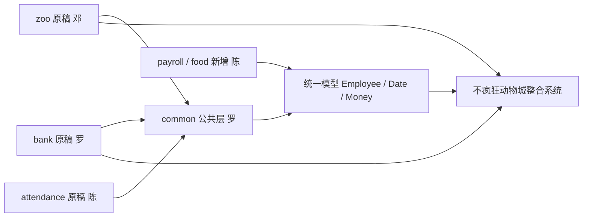

---

## 2. 类体系设计

### 2.1 总类图

当前类体系可以分成五组：

- **人员与动物园**：`Employee` → `animal` → `bird` / `mammal` → 具体动物；`zoo` 聚合 `animal*`。
- **银行账户**：`BankAccount` → `SavingsAccount` / `CreditAccount`；`BankService` 聚合账户和流水，`BankStorage` 负责 CSV。
- **考勤与工资**：`Record`、`dayRecord`、`Basic`、`AttendanceSummary`、`FileOperation`；工资侧 `PayrollRecord`、`SalaryPolicy`、`PayrollService`、`PayrollStorage`。
- **食物购买**：`Food`、`FoodPurchaseRecord`、`FoodPurchaseService`、`FoodStorage`。
- **界面入口**：`QtApp/main.cpp` 创建 `QApplication` 和 `MainWindow`；`MainWindow` 组合所有服务对象，用 `QStackedWidget` 切换登录页、员工页、管理者页。

> 类图只表达继承、聚合和依赖关系；每个类型的“写/改”作者统一放在 2.2 的表中，避免图内文字过密。`FoodPurchaseRecord` 目前没有字段，暂不画进结构类图。

#### 图 2-1 人员与动物园类图

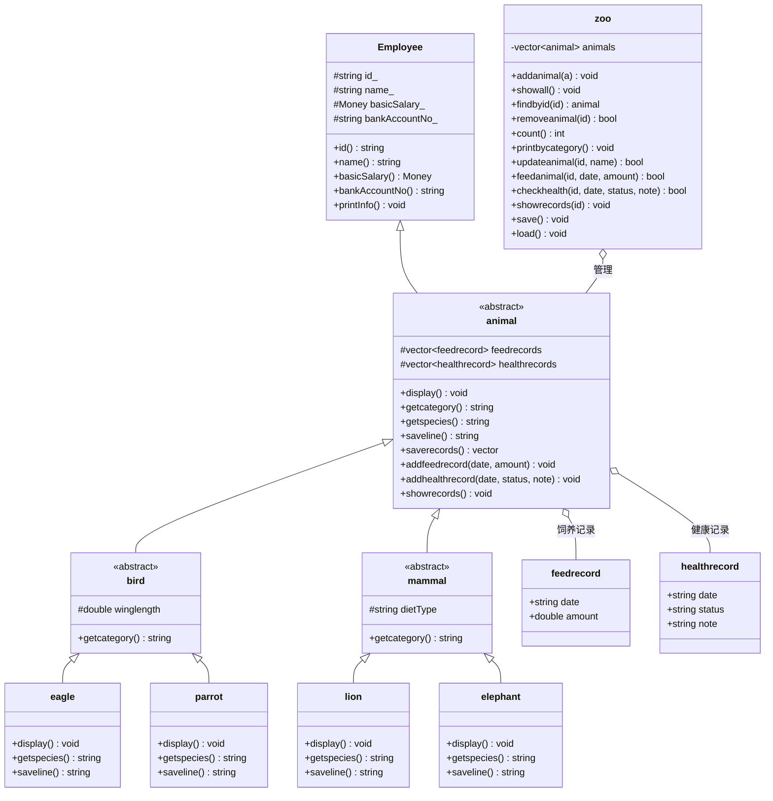

#### 图 2-2 银行类图

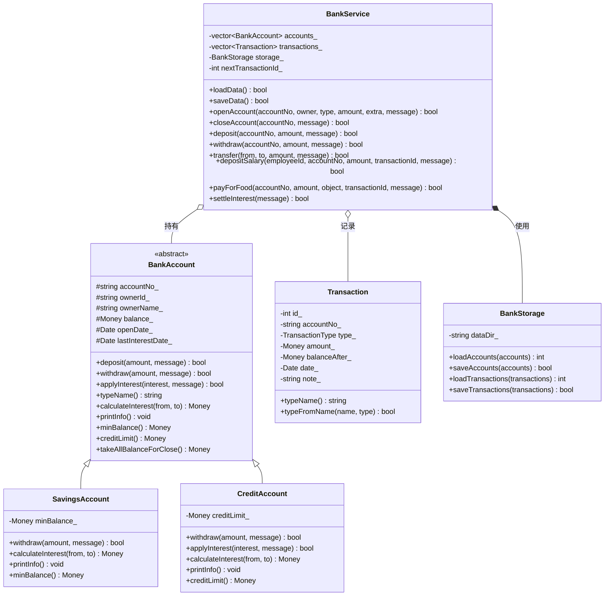

#### 图 2-3 考勤、工资、食物类图

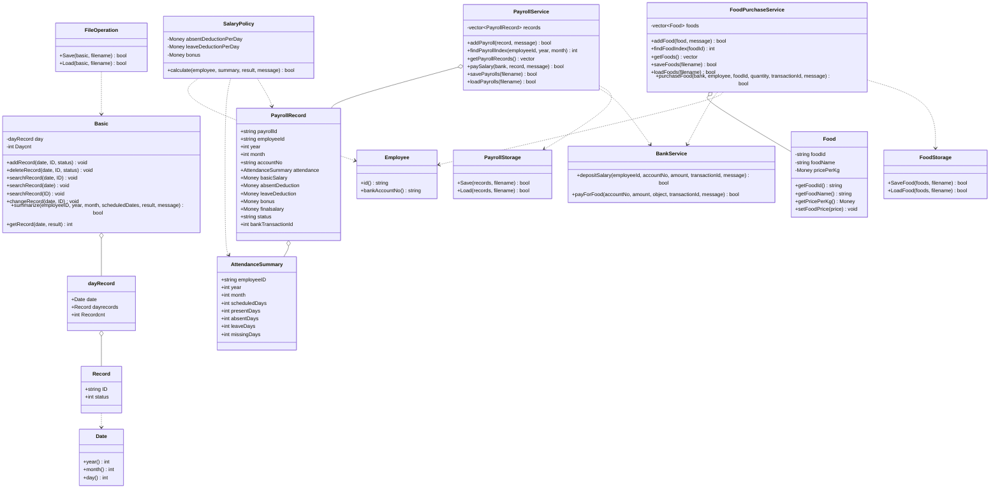

#### 图 2-4 界面入口类图

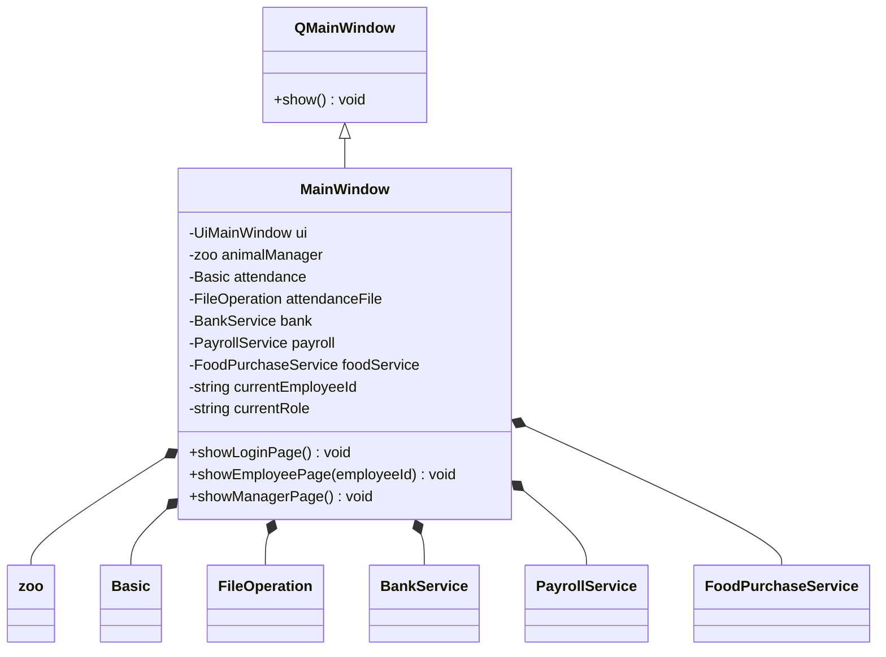

`MainWindow` 是当前唯一的界面类，构造时把六个业务对象作为成员一起创建（组合），因此各页面看到的是同一份 `zoo`、考勤、银行、工资、食物数据。`Ui::MainWindow` 由 `mainwindow.ui` 经 Qt `uic` 生成，不是手写类，不单独统计作者。

#### 继承关系速查

```text
Employee（罗→陈）
└── animal（邓→陈，抽象）
    ├── bird（邓→陈，抽象；+ winglength）
    │   ├── eagle（邓→陈）
    │   └── parrot（邓→陈）
    └── mammal（邓→陈，抽象；+ dietType）
        ├── lion（邓→陈）
        └── elephant（邓→陈）

BankAccount（罗，抽象）
├── SavingsAccount（罗；+ minBalance_）
└── CreditAccount（罗；+ creditLimit_）

QMainWindow（Qt 框架）
└── MainWindow（陈；组合 zoo、Basic、FileOperation、BankService、PayrollService、FoodPurchaseService）
```

`FoodPurchaseRecord` 目前只有声明、没有字段，未画进类图；它是食物购买单的占位类型，见 2.4.6。

### 2.2 类清单与作者标注

#### 2.2.1 公共类型 `common/`

| 类型 | 文件 | 来源 | 写 | 改 | 说明 |
| --- | --- | --- | --- | --- | --- |
| `Date` | `common/Date.h`、`Date.cpp` | bank | 罗 | 陈 | 日期值类型；陈增加 `operator==`，供考勤按日期比较 |
| `Money` | `common/Money.h` | bank | 罗 | — | `typedef long long`，单位“分”；不是类 |
| `Employee` | `common/Employee.h`、`Employee.cpp` | bank | 罗 | 陈 | 增加 `basicSalary_`、`bankAccountNo_` 及访问器；成为 `animal` 的基类 |

#### 2.2.2 动物园 `zoo/`

| 类型 | 文件 | 来源 | 写 | 改 | 说明 |
| --- | --- | --- | --- | --- | --- |
| `feedrecord` | `zoo/feedrecord.h` | zoo | 邓 | 陈（仅注释） | 饲养记录：日期 + 数量 |
| `healthrecord` | `zoo/healthrecord.h` | zoo | 邓 | 陈（仅注释） | 健康记录：日期 + 状态 + 备注 |
| `animal` | `zoo/animal.h`、`animal.cpp` | zoo | 邓 | 陈（实质） | 改为继承 `Employee`；删去重复 `id/name`；`getid/getname` 转调父类；`saveline` 增加工资、账号 |
| `bird` | `zoo/animal.h`、`animal.cpp` | zoo | 邓 | 陈（实质） | 中间抽象类；增加翼展；构造链改传员工资料 |
| `mammal` | `zoo/animal.h`、`animal.cpp` | zoo | 邓 | 陈（实质） | 中间抽象类；保存食性；构造链改传员工资料 |
| `eagle` | `zoo/animal.h`、`animal.cpp` | zoo | 邓 | 陈（实质） | 具体鸟类；`saveline` 增加工资、账号 |
| `parrot` | `zoo/animal.h`、`animal.cpp` | zoo | 邓 | 陈（实质） | 具体鸟类；`saveline` 增加工资、账号 |
| `lion` | `zoo/animal.h`、`animal.cpp` | zoo | 邓 | 陈（实质） | 具体哺乳类；`saveline` 增加工资、账号 |
| `elephant` | `zoo/animal.h`、`animal.cpp` | zoo | 邓 | 陈（实质） | 具体哺乳类；`saveline` 增加工资、账号 |
| `zoo` | `zoo/zoo.h`、`zoo.cpp` | zoo | 邓 | 陈（实质） | 管理 `animal*`；`load` 恢复工资、账号；其余接口沿用 |

#### 2.2.3 考勤 `attendance/`

| 类型 | 文件 | 来源 | 写 | 改 | 说明 |
| --- | --- | --- | --- | --- | --- |
| `Record` | `attendance/Record.h` | attendance | 陈 | 陈 | 员工编号 + 状态；状态 0 缺勤、1 出勤、2 请假 |
| `dayRecord` | `attendance/Record.h` | attendance | 陈 | 陈 | 一天的所有考勤记录；`Date` 改为公共 `Date` |
| `Basic` | `attendance/Basic.h`、`Basic.cpp` | attendance | 陈 | 陈 | 考勤增删查改；新增 `summarize()` 月度统计 |
| `AttendanceSummary` | `attendance/AttendanceSummary.h` | 其他 | 陈 | — | 月度汇总值对象：应出勤、出勤、缺勤、请假、未录入 |
| `FileOperation` | `attendance/FileOperation.h`、`FileOperation.cpp` | attendance | 陈 | 陈 | 考勤文件读写；适配公共 `Date` 的访问器 |
| `Date`（考勤原结构体） | 合并前 `attendance/Record.h` | attendance | 陈 | 陈（已删除） | 统一接口后由 `common/Date` 取代；当前源码中已不存在 |

#### 2.2.4 银行 `bank/`

| 类型 | 文件 | 来源 | 写 | 改 | 说明 |
| --- | --- | --- | --- | --- | --- |
| `BankAccount` | `bank/BankAccount.h`、`BankAccount.cpp` | bank | 罗 | 陈（仅注释） | 抽象账户基类；储蓄/信用的公共规则 |
| `SavingsAccount` | `bank/BankAccount.h`、`BankAccount.cpp` | bank | 罗 | — | 储蓄账户；最低留存余额、年利率 1.5% |
| `CreditAccount` | `bank/BankAccount.h`、`BankAccount.cpp` | bank | 罗 | — | 信用账户；可透支、日利率 0.05% |
| `Transaction` | `bank/Transaction.h` | bank | 罗 | 陈（仅注释） | 交易流水值对象；食物消费枚举仍待补 |
| `BankService` | `bank/BankService.h`、`BankService.cpp` | bank | 罗 | 陈（实质） | 改写 `depositSalary` 签名；新增 `payForFood` |
| `BankStorage` | `bank/BankStorage.h`、`BankStorage.cpp` | bank | 罗 | 陈（仅注释） | `accounts.csv`、`transactions.csv` 读写 |
| `MainMenu` | 合并前 `app/MainMenu.*` | bank | 罗 | 未并入 | 银行界面层；当前项目没有该文件，`QtApp/MainWindow` 是新写界面，不是它 |

#### 2.2.5 工资 `payroll/`

| 类型 | 文件 | 来源 | 写 | 改 | 说明 |
| --- | --- | --- | --- | --- | --- |
| `PayrollRecord` | `payroll/PayrollRecord.h` | 其他 | 陈 | — | 月度工资单；保存考勤快照、工资明细、发放状态、银行流水号 |
| `SalaryPolicy` | `payroll/SalaryPolicy.h`、`SalaryPolicy.cpp` | 其他 | 陈 | — | 工资规则；按缺勤/请假天数扣款并加奖金 |
| `PayrollService` | `payroll/PayrollService.h`、`PayrollService.cpp` | bank（原 `app/PayrollService`） | 罗 | 陈（实质） | 原为工资入账薄封装；现为工资单集合 + 发放服务 |
| `PayrollStorage` | `payroll/PayrollStorage.h`、`PayrollStorage.cpp` | 其他 | 陈 | — | 工资单文件读写 |

#### 2.2.6 食物 `food/`

| 类型 | 文件 | 来源 | 写 | 改 | 说明 |
| --- | --- | --- | --- | --- | --- |
| `Food` | `food/Food.h`、`Food.cpp` | 其他 | 陈 | — | 食物目录项：编号、名称、每公斤单价 |
| `FoodPurchaseRecord` | `food/FoodPurchaseRecord.h` | 其他 | 陈 | — | 购买单占位类型，当前无字段 |
| `FoodPurchaseService` | `food/FoodPurchaseService.h`、`FoodPurchaseService.cpp` | 其他 | 陈 | — | 食物目录管理 + 购买扣款 |
| `FoodStorage` | `food/FoodStorage.h`、`FoodStorage.cpp` | 其他 | 陈 | — | 食物目录文件读写 |

#### 2.2.7 界面入口 `QtApp/`

| 类型 | 文件 | 来源 | 写 | 改 | 说明 |
| --- | --- | --- | --- | --- | --- |
| `MainWindow` | `QtApp/mainwindow.h`、`mainwindow.cpp`、`managerpage.cpp`、`employeepage.cpp` | 其他 | 陈 | — | `QMainWindow` 派生；组合六个业务服务；管理者五标签页 + 员工五标签页；登录后按角色切换 |
| `SqliteExporter` | `QtApp/sqliteexporter.h`、`sqliteexporter.cpp` | 其他 | 陈 | — | SQLite 导出工具；把全部业务数据写成 .db，界面只读调用 |
| `Ui::MainWindow` | `QtApp/mainwindow.ui` 生成 | 其他 | Qt `uic` 生成 | — | 由 `.ui` 生成的界面类，不是手写类；`mainwindow.cpp` 通过 `ui->...` 使用 |
| `main` | `QtApp/main.cpp` | 其他 | 陈 | — | 入口函数，不是类；创建 `QApplication` 和 `MainWindow` |

> `QtApp/` 是当前工作区新增的界面骨架，本文按题目约定“其他 = 陈”归档；若实际作者另有其人，把该表的“写”改成实际作者即可。`MainWindow` 不是合并前银行 `MainMenu` 的改名，而是新写的 Qt 主窗口；`MainMenu` 仍未并入。

### 2.3 统一接口引起的类名、位置、职责改写

这一节专门回答“统一接口导致的类名改写，同样标注编写者和改写者”。

| 原类型/接口 | 当前类型/接口 | 改写内容 | 写 | 改 |
| --- | --- | --- | --- | --- |
| 考勤 `struct Date`（`attendance/Record.h`） | `common::Date`（`common/Date.h`） | 类名同为 `Date`，但定义来源从考勤内部改为银行公共层；删除考勤 `Date`，`dayRecord`、`Basic`、`FileOperation` 改用 `year()/month()/day()` 访问器；`operator==` 由陈补在公共 `Date` 上 | 陈（原结构体） | 陈；公共 `Date` 原写：罗 |
| `app::PayrollService`（薄封装） | `payroll::PayrollService`（工资单服务） | 类名保留，目录从 `src/app/` 移到 `src/payroll/`；职责从“转调银行入账”改为“维护工资单、查询、发放、保存”；`paySalary` 参数从工号 + 金额改为 `PayrollRecord&` | 罗 | 陈 |
| `animal` 内的 `id`、`name` 字段 | `Employee::id_`、`Employee::name_` | 字段上移到员工基类；`animal` 删除重复字段；`getid/getname/setname/setid` 全部转调 `Employee`；构造链改为 `Employee(id, name)` | 邓 | 陈 |
| `BankService::depositSalary(employeeId, amount, message)` | `BankService::depositSalary(employeeId, accountNo, amount, transactionId, message)` | 增加指定账号、返回流水号；从“按员工找第一个账户”改为“按明确账号入账”；为工资单回填流水号服务 | 罗 | 陈 |
| `app::PayrollService::paySalary(bank, employeeId, amount, message)` | `payroll::PayrollService::paySalary(bank, PayrollRecord& record, message)` | 从手工金额入账改为按工资单发放；内部先按员工 + 年月找工资单，再调用银行 | 罗 | 陈 |
| `zoo::animal` 的继承关系 | `class animal : public Employee` | `animal` 从独立类改为 `Employee` 派生类；这是“统一员工身份”的核心改动，不是改名 | 邓 | 陈 |
| `MainMenu`（bank） | `QtApp::MainWindow`（新写，不是改名） | 银行 `MainMenu` 未并入；当前 Qt 主窗口由陈新写，组合六个业务服务。若把 `MainMenu` 的登录/菜单逻辑迁移到 `MainWindow`，迁移部分按“写：罗，改：陈”标注 | 罗（原 `MainMenu`） | 陈（新写 `MainWindow`）；迁移 `MainMenu` 逻辑时改：陈 |

需要特别说明：

- 当前真正的“类名/来源改写”主要有两类：考勤 `Date` 被公共 `Date` 取代（类名相同、定义来源从陈改为罗，考勤侧改写由陈完成）；`app::PayrollService` 迁移为 `payroll::PayrollService`（类名保留、目录和职责改变，原写罗、改写陈）。`MainWindow` 是新写的界面类，不是 `MainMenu` 的改名；`animal` 的 `id/name` 上移是字段迁移，不是类名改写。
- 截至当前源码，**没有**把 `Basic` 改名为 `AttendanceService`、把 `FileOperation` 改名为 `AttendanceStorage`、把 `zoo` 改名为 `Zoo`、把 `animal` 改名为 `Animal`。这些名字仍保持合并前原样。报告中不要写不存在的“改名”。
- `PayrollService.h` 的头文件保护宏仍是合并前银行 `app` 目录的 `APP_PAYROLLSERVICE_H`，属于迁移残留，不影响编译；若最终统一命名，可改为 `PAYROLL_PAYROLLSERVICE_H`，并按“写：罗，改：陈”标注。

### 2.4 各类说明

#### 2.4.1 公共基础类型

**`Date`（`common/Date.h`、`Date.cpp`；来源：bank；写：罗，改：陈）**

- **职责**：表示公历日期，提供合法性判断、闰年判断、当月天数、`YYYY-MM-DD` 解析与输出、日期比较、相差天数。
- **数据**：`year_`、`month_`、`day_`；私有 `toDayNumber()` 把日期换算成“从公元 1 年起的第几天”。
- **接口**：`isValid()`、`isLeapYear()`、`daysInMonth()`、`toString()`、`parse()`、`today()`、`isBefore()`、`isSame()`、`daysBetween()`、`operator==`。
- **协作**：银行用它保存开户日期、上次结息日期、交易日期；考勤用它保存 `dayRecord::date` 并做按日查找。
- **现状**：陈为支持考勤的 `day[i].date == date` 比较，增加了 `operator==`；其余实现沿用罗的原稿。

**`Money`（`common/Money.h`、`Money.cpp`；来源：bank；写：罗）**

- **职责**：统一金额类型和元/分转换。
- **定义**：`typedef long long Money;`，单位是“分”，100 表示 1.00 元。
- **接口**：`moneyToString()` 把分转成“元”字符串；`parseMoney()` 把用户输入转成分，限制最多两位小数、可选正号、上限检查。
- **协作**：账户余额、交易金额、工资、食物单价全部使用它，避免 `double` 累加误差；只有利息计算临时用 `double`，算完四舍五入回分。

**`Employee`（`common/Employee.h`、`Employee.cpp`；来源：bank；写：罗，改：陈）**

- **职责**：全系统统一的“员工/动物员工”身份基类，保存编号、姓名、基本工资、工资/消费账号。
- **数据**：`id_`、`name_`、`basicSalary_`（默认 0，单位分）、`bankAccountNo_`。
- **接口**：`id()`、`name()`、`basicSalary()`、`bankAccountNo()` 及 setter；虚析构；`virtual printInfo()`。
- **协作**：`animal` 公开继承它；`BankService::openAccount()` 接收 `const Employee&` 取得户主编号和姓名；`SalaryPolicy::calculate()` 读取基本工资和账号；`FoodPurchaseService::purchaseFood()` 读取员工编号和账号。
- **现状**：罗的原稿只有编号、姓名；陈增加工资、账号字段，并在 `animal.h` 中把 `animal` 改为 `public Employee`。`setId()` 目前仍允许直接改编号；“已关联业务后禁止改编号”的约束只在注释里，尚未实现。

#### 2.4.2 动物园模块

**`feedrecord`（`zoo/feedrecord.h`；来源：zoo；写：邓）**

- **职责**：一次饲养/进食记录。
- **数据**：`date`（字符串日期）、`amount`（公斤数）。
- **现状**：没有食物编号、购买编号；`FoodPurchaseService` 购买成功后尚未回写进食记录，因此“同一购买只记一次”的关联还没落地。

**`healthrecord`（`zoo/healthrecord.h`；来源：zoo；写：邓）**

- **职责**：一次健康检查记录。
- **数据**：`date`、`status`（如健康/亚健康/生病）、`note`。
- **现状**：日期仍是字符串，尚未改用公共 `Date` 校验。

**`animal`（`zoo/animal.h`、`animal.cpp`；来源：zoo；写：邓，改：陈）**

- **职责**：动物员工抽象基类，保存饲养记录、健康记录，定义所有动物必须实现的显示、分类、物种、保存行接口。
- **数据**：`vector<feedrecord> feedrecords`、`vector<healthrecord> healthrecords`；编号、姓名、工资、账号从 `Employee` 继承。
- **接口**：
  - 纯虚：`display()`、`getcategory()`、`getspecies()`、`saveline()`；
  - 普通：`getid()`、`getname()`、`saverecords()`、`addfeedrecord()`、`addhealthrecord()`、`showrecords()`；
  - `setname()`、`setid()` 转调 `Employee::setName()`、`Employee::setId()`。
- **协作**：`zoo` 以 `vector<animal*>` 管理；`showall()`、`printbycategory()` 通过虚函数 `display()` 输出；`saveline()` 被 `zoo::save()` 调用。
- **现状**：陈删除了原来的 `id`、`name` 字段，改为继承 `Employee`；`saveline()` 从“物种 + 编号 + 姓名 + 专属属性”扩展为再加工资、账号；`getid/getname` 返回的是 `string` 副本。

**`bird` / `mammal`（`zoo/animal.h`、`animal.cpp`；来源：zoo；写：邓，改：陈）**

| 类 | 额外数据 | 已实现行为 | 说明 |
| --- | --- | --- | --- |
| `bird` | `double winglength` | `getcategory()` 返回“鸟类” | 仍是抽象类，`display/getspecies/saveline` 留给具体鸟 |
| `mammal` | `string dietType` | `getcategory()` 返回“哺乳动物” | 仍是抽象类，`dietType` 保存“肉食/草食”等 |

**`eagle` / `parrot` / `lion` / `elephant`（`zoo/animal.h`、`animal.cpp`；来源：zoo；写：邓，改：陈）**

| 类 | 父类 | 专属字段 | `display()` 显示 | `saveline()` 字段顺序 |
| --- | --- | --- | --- | --- |
| `eagle` | `bird` | `winglength` | 编号、名称、翼展 | `eagle → id → name → winglength → basicSalary → bankAccountNo` |
| `parrot` | `bird` | `winglength` | 编号、名称、翼展 | `parrot → id → name → winglength → basicSalary → bankAccountNo` |
| `lion` | `mammal` | `dietType` 固定“肉食” | 编号、名称、食性 | `lion → id → name → basicSalary → bankAccountNo` |
| `elephant` | `mammal` | `dietType` 固定“草食” | 编号、名称、食性 | `elephant → id → name → basicSalary → bankAccountNo` |

- 构造链统一为 `具体动物 → bird/mammal → animal → Employee`，编号、姓名一路传到员工基类。
- 陈改写时保留了原有多态接口，只把 `display()`/`saveline()` 中直接访问 `id`、`name` 的地方改为 `getid()`、`getname()`，并在保存行末尾追加基本工资和银行账号。

**`zoo`（`zoo/zoo.h`、`zoo.cpp`；来源：zoo；写：邓，改：陈）**

- **职责**：动物园员工集合的管理者，负责添加、显示、按编号查找、删除、分类显示、改名、饲养、健康检查、记录查看、保存/加载。
- **数据**：`vector<animal*> animals`。
- **接口**：`addanimal()`、`showall()`、`findbyid()`、`removeanimal()`、`count()`、`printbycategory()`、`updateanimal()`、`feedanimal()`、`checkhealth()`、`showrecords()`、`save()`、`load()`。
- **所有权**：`zoo` 析构时 `delete` 所有 `animal*`；`addanimal()` 成功入容器后由 `zoo` 负责释放，调用方不要再 delete。
- **现状**：`addanimal()` 还没有检查编号唯一；`removeanimal()` 仍是直接 `delete`，没有保护历史考勤/账户/工资；`load()` 已能恢复工资和账号，但用 `stoll/stod` 且未检查字段数量和转换异常。

#### 2.4.3 考勤模块

**`Record`（`attendance/Record.h`；来源：attendance；写：陈）**

- **职责**：某员工某一天的考勤结果。
- **数据**：`ID`（员工编号）、`status`（0 缺勤、1 出勤、2 请假）。
- **接口**：默认构造、`Record(ID, status)` 构造。
- **约定**：没有记录表示“未录入”，不能直接当成缺勤；这一点由 `Basic::summarize()` 用 `missingDays` 单独统计。

**`dayRecord`（`attendance/Record.h`；来源：attendance；写：陈）**

- **职责**：按日期分组的一天考勤记录。
- **数据**：`Date date`、`Record dayrecords[100]`、`int Recordcnt`。
- **说明**：`Date` 已改为公共 `common::Date`；每天最多 100 条，`Basic` 最多 366 个日期。

**`Basic`（`attendance/Basic.h`、`Basic.cpp`；来源：attendance；写：陈）**

- **职责**：考勤记录的核心容器和增删查改服务，并提供月度汇总。
- **数据**：`dayRecord day[366]`、`int Daycnt`；`friend class FileOperation` 允许存储类直接读写私有数组。
- **接口**：
  - `addRecord(Date, ID, status)`：按日期分组添加；新日期检查 366 上限，已有日期检查该员工是否重复、当天是否满 100 条；
  - `deleteRecord(Date, ID, status)`：要求状态也匹配才删除；
  - `searchRecord(Date, ID)`、`searchRecord(Date)`、`searchRecord(ID)`：三种重载；
  - `changeRecord(Date, ID)`：当前实现内部用 `cin` 读新状态；
  - `summarize(employeeID, year, month, scheduledDates, result, message)`：按排班日期统计出勤、缺勤、请假、未录入；
  - `getRecord(Date, Record result[])`：取出某天全部记录，供汇总复用。
- **协作**：`FileOperation` 负责保存/加载；`SalaryPolicy` 不直接依赖 `Basic`，而是接收 `AttendanceSummary`。
- **现状**：`addRecord` 还没有校验员工是否存在、状态是否在 0~2；`changeRecord` 仍在业务函数里读 `cin`；`deleteRecord/changeRecord` 还没有检查该月工资是否已结算。

**`AttendanceSummary`（`attendance/AttendanceSummary.h`；来源：其他；写：陈）**

- **职责**：月度考勤统计值对象，作为工资计算的输入快照。
- **数据**：`employeeID`、`year`、`month`、`scheduledDays`（应出勤）、`presentDays`（出勤）、`absentDays`（缺勤）、`leaveDays`（请假）、`missingDays`（未录入）。
- **协作**：`Basic::summarize()` 产出；`PayrollRecord::attendance` 保存；`SalaryPolicy::calculate()` 读取。

**`FileOperation`（`attendance/FileOperation.h`、`FileOperation.cpp`；来源：attendance；写：陈）**

- **职责**：考勤记录的文件保存与加载。
- **格式**：每行 `年 月 日 员工编号 状态`，空格分隔。
- **接口**：`Save(const Basic&, filename)`、`Load(Basic&, filename)`。
- **现状**：`Load()` 边读边 `addRecord()`，如果后面的行坏掉，前面已经加入的记录会留在目标对象里；更稳妥的做法是先读入临时 `Basic`，全部成功后再替换。

#### 2.4.4 银行模块

**`BankAccount`（`bank/BankAccount.h`、`BankAccount.cpp`；来源：bank；写：罗）**

- **职责**：所有账户的抽象基类，保存账号、户主编号、户主姓名、余额、开户日期、上次结息日期。
- **数据**：`accountNo_`、`ownerId_`、`ownerName_`、`balance_`（分）、`openDate_`、`lastInterestDate_`。
- **接口**：
  - 已实现：`deposit()`、`applyInterest()`、`printInfo()`、`minBalance()`、`creditLimit()`、`takeAllBalanceForClose()`、`setLastInterestDate()`；
  - 纯虚：`withdraw()`、`calculateInterest()`、`typeName()`。
- **多态**：`BankService` 用 `vector<BankAccount*>` 管理派生对象，取款、计息、类型名都由虚函数分派；析构函数为虚函数，`delete` 基类指针能正确析构派生类。
- **现状**：陈只调整了 `protected` 成员的位置并补了注释，没有改行为。

**`SavingsAccount`（`bank/BankAccount.h`、`BankAccount.cpp`；来源：bank；写：罗）**

- **额外数据**：`minBalance_`（最低留存余额，分）。
- **取款规则**：金额必须大于 0，且 `balance_ - amount >= minBalance_`。
- **计息规则**：`余额 × 1.5% × 天数 / 365`，四舍五入到分；利息通过基类 `applyInterest()` 存入余额。
- **显示**：在基类信息后追加最低留存余额。

**`CreditAccount`（`bank/BankAccount.h`、`BankAccount.cpp`；来源：bank；写：罗）**

- **额外数据**：`creditLimit_`（信用额度，分）。
- **取款规则**：金额必须大于 0，且 `balance_ - amount >= -creditLimit_`，允许透支。
- **计息规则**：余额为负时，按 `欠款 × 0.05% × 天数` 计息；利息通过重写的 `applyInterest()` 计入欠款（余额减少）。
- **显示**：在基类信息后追加信用额度；有欠款时显示欠款和可用额度。

**`Transaction`（`bank/Transaction.h`；来源：bank；写：罗）**

- **职责**：一条交易流水的值对象。
- **数据**：流水号、账号、类型、金额、交易后余额、日期、备注。
- **枚举**：`TX_DEPOSIT`、`TX_WITHDRAW`、`TX_TRANSFER_IN`、`TX_TRANSFER_OUT`、`TX_SALARY`、`TX_INTEREST`。
- **接口**：各字段 getter、`typeName()`、静态 `typeFromName()`；实现全部内联在头文件。
- **现状**：还没有 `TX_FOOD_PURCHASE`，食物购买目前记成 `TX_WITHDRAW`，流水无法按“食物消费”分类；这是 `Transaction.h` 中 `[需补全]` 的内容。

**`BankService`（`bank/BankService.h`、`BankService.cpp`；来源：bank；写：罗，改：陈）**

- **职责**：银行核心业务服务，管理账户集合、流水集合和 CSV 存储。
- **数据**：`vector<BankAccount*> accounts_`、`vector<Transaction> transactions_`、`BankStorage storage_`、`int nextTransactionId_`。
- **接口**：
  - 数据：`loadData()`、`saveData()`；
  - 账户：`openAccount()`、`closeAccount()`、`findAccount()`、`findFirstAccountByOwner()`、`printAllAccounts()`、`printAccountsByOwner()`；
  - 资金：`deposit()`、`withdraw()`、`transfer()`、`settleInterest()`；
  - 跨模块：`depositSalary()`、`payForFood()`；
  - 流水：`printTransactions()`、`printTransactionsByDate()`；
  - 私有：`addTransaction()`。
- **多态点**：`withdraw()`、`calculateInterest()`、`applyInterest()`、`typeName()`、`printInfo()` 通过基类指针调用，自动执行储蓄/信用版本。
- **所有权**：析构时 `delete` 所有 `accounts_`；拷贝构造和赋值声明为私有，禁止复制。
- **现状**：陈把 `depositSalary` 从“按员工找第一个账户”改为“按明确账号入账 + 返回流水号”，并新增 `payForFood()`；`saveData()` 仍是账户、流水分别保存，不是原子操作。

**`BankStorage`（`bank/BankStorage.h`、`BankStorage.cpp`；来源：bank；写：罗）**

- **职责**：账户和流水的 CSV 持久化。
- **文件**：
  - `accounts.csv`：账号、员工编号、姓名、类型、余额（分）、最低余额（分）、信用额度（分）、开户日期、上次结息日期；
  - `transactions.csv`：流水号、账号、类型、金额（分）、交易后余额（分）、日期、备注。
- **关键行为**：`loadAccounts()` 按“储蓄账户/信用账户”创建派生对象，拒绝重复账号；`saveAccounts()` 通过虚函数 `typeName()/minBalance()/creditLimit()` 取得各账户自己的字段；坏行跳过。
- **现状**：陈只补了注释，没有改读写逻辑。

#### 2.4.5 工资模块

**`PayrollRecord`（`payroll/PayrollRecord.h`；来源：其他；写：陈）**

- **职责**：某员工某个月的工资单，是工资计算和发放之间的数据载体。
- **数据**：`payrollId`、`employeeId`、`year`、`month`、`accountNo`、`AttendanceSummary attendance`、`basicSalary`、`absentDeduction`、`leaveDeduction`、`bonus`、`finalsalary`、`status`（“未发放/已发放”）、`bankTransactionId`。
- **说明**：它是“快照”而不是实时视图：已发放工资单保留当时的考勤统计和金额，不随之后的考勤或基本工资变化而改写。
- **现状**：字段公开，实质上是数据类；`status` 用字符串，后续可考虑枚举。

**`SalaryPolicy`（`payroll/SalaryPolicy.h`、`SalaryPolicy.cpp`；来源：其他；写：陈）**

- **职责**：工资计算规则，和工资单数据、银行发放分离。
- **数据**：`absentDeductionPerDay`（缺勤每天扣款）、`leaveDeductionPerDay`（请假每天扣款）、`bonus`（奖金）。
- **接口**：`calculate(employee, summary, result, message)`。
- **计算**：
  - 先校验 `summary.employeeID == employee.id()` 且编号非空；
  - 校验 `presentDays + absentDays + leaveDays + missingDays == scheduledDays`；
  - 有未录入天数时拒绝计算；
  - `finalsalary = basicSalary - absentDays × 日扣款 - leaveDays × 日扣款 + bonus`；
  - 生成 `PayrollRecord`，状态置“未发放”，`bankTransactionId` 置 0。
- **现状**：目前是固定每日扣款，不是按工资比例；没有检查实发为负的情况。

**`PayrollService`（`payroll/PayrollService.h`、`PayrollService.cpp`；来源：bank 原 `app/PayrollService`；写：罗，改：陈）**

- **职责**：维护工资单集合，并提供“按工资单发放工资”的跨模块接口。
- **数据**：`vector<PayrollRecord> records`。
- **接口**：`addPayroll()`、`findPayrollIndex(employeeId, year, month)`、`getPayrollRecords()`、`paySalary(bank, record, message)`、`savePayrolls()`、`loadPayrolls()`。
- **发放流程**：`paySalary()` 先按员工 + 年月找到工资单，再调用 `BankService::depositSalary()`；成功后把银行返回的流水号写回 `bankTransactionId`，状态改为“已发放”，并更新 `records` 中对应项。注意：实际入账金额和账号取自传入的 `record` 参数，而不是重新从 `records[index]` 取；`addPayroll()` 目前只是 `push_back`，不检查同员工同月重复。
- **现状**：没有检查工资单是否已发放，重复调用可能重复入账；发放成功后没有自动调用 `savePayrolls()`，需要调用方保存。

**`PayrollStorage`（`payroll/PayrollStorage.h`、`PayrollStorage.cpp`；来源：其他；写：陈）**

- **职责**：工资单文本文件读写。
- **格式**：空格分隔，一行一张工资单，包含工资单字段和 `AttendanceSummary` 的 8 个字段。
- **关键行为**：`Load()` 先读入临时 `vector<PayrollRecord>`，全部成功后再替换输出参数，避免半份数据覆盖旧数据。
- **限制**：字符串字段不能包含空格；格式错误会整体返回 false。

#### 2.4.6 食物模块

**`Food`（`food/Food.h`、`Food.cpp`；来源：其他；写：陈）**

- **职责**：食物目录项。
- **数据**：`foodId`、`foodName`、`pricePerKg`（分/公斤）。
- **接口**：构造、`getFoodId()`、`getFoodName()`、`getPricePerKg()`、`setFoodPrice()`。
- **说明**：只维护目录和价格，不承担库存；购买数量按公斤整数计算。

**`FoodPurchaseRecord`（`food/FoodPurchaseRecord.h`；来源：其他；写：陈）**

- **职责**：预留的食物购买单类型。
- **现状**：当前是空结构体，没有字段；购买编号、员工、食物、数量、金额、账号、日期、状态、银行流水号等尚未落地。因此当前 `FoodPurchaseService::purchaseFood()` 只完成扣款，没有生成购买单。

**`FoodPurchaseService`（`food/FoodPurchaseService.h`、`FoodPurchaseService.cpp`；来源：其他；写：陈）**

- **职责**：食物目录管理，以及“员工用银行账户买食物”的流程。
- **数据**：`vector<Food> foods`。
- **接口**：`addFood()`、`findFoodIndex()`、`getFoods()`、`saveFoods()`、`loadFoods()`、`purchaseFood()`。
- **购买流程**：按 `foodId` 找到食物；`totalCost = pricePerKg × quantity`；调用 `BankService::payForFood(employee.bankAccountNo(), totalCost, info, transactionId, message)`。
- **现状**：`addFood()` 只是 `push_back`，不检查 `foodId` 重复；`findFoodIndex()` 返回第一个匹配项。购买流程没有校验数量大于 0、价格非负、员工账号已绑定；没有生成 `FoodPurchaseRecord`，也没有调用 `zoo::feedanimal()` 写进食记录，购买与饲养还未闭环。

**`FoodStorage`（`food/FoodStorage.h`、`FoodStorage.cpp`；来源：其他；写：陈）**

- **职责**：食物目录文件读写。
- **格式**：每行 `食物编号 食物名称 单价分`，空格分隔。
- **关键行为**：`LoadFood()` 先读入临时 `vector<Food>`，成功后再替换。
- **限制**：名称不能含空格；没有检查食物编号是否重复。

#### 2.4.7 界面入口

**`MainWindow`（`QtApp/mainwindow.h`、`mainwindow.cpp`；来源：其他；写：陈）**

- **职责**：Qt Widgets 主窗口和整合入口，负责登录页、员工页、管理者页的切换，并持有全系统业务对象。
- **数据**：
  - `Ui::MainWindow *ui`：由 `mainwindow.ui` 生成的界面；
  - `zoo animalManager`、`Basic attendance`、`FileOperation attendanceFile`、`BankService bank`、`PayrollService payroll`、`FoodPurchaseService foodService`：六个业务对象，按值组合；
  - `currentEmployeeId`、`currentRole`：登录成功后保存当前员工编号和角色（“员工/管理者”）。
- **接口**：构造、析构、`showLoginPage()`、`showEmployeePage(employeeId)`、`showManagerPage()`。
- **现状**：`mainwindow.ui` 只有 `pageStack` 和三个空页面（`loginPage`、`employeePage`、`managerPage`）；`MainWindow` 构造函数只 `setupUi` + `showLoginPage`，没有调用 `loadData`/`load`，没有登录校验，也没有业务按钮和槽函数。`showEmployeePage`/`showManagerPage` 目前只记录身份并切换页面，还没有被任何登录逻辑调用。
- **协作**：由于六个服务对象是 `MainWindow` 的成员，各页面拿到的是同一份数据；后续补业务页时，应通过 `animalManager`、`attendance`、`bank`、`payroll`、`foodService` 调用现有接口，而不是在界面里直接改余额或数组。
- **`Ui::MainWindow`**：由 Qt `uic` 根据 `mainwindow.ui` 生成，不是手写类；报告中不要把生成类算作某位成员编写的类。
- **`main`（`QtApp/main.cpp`）**：程序入口函数，创建 `QApplication` 和 `MainWindow`，不是类。

**`SqliteExporter`（`QtApp/sqliteexporter.h`、`sqliteexporter.cpp`；来源：其他；写：陈）**

- **职责**：把当前内存中的动物员工、饲养/健康记录、考勤、银行账户/流水、工资单、食物目录/购买记录导出为一个 SQLite 数据库。
- **接口**：`static bool exportAll(filePath, zoo&, Basic&, BankService&, PayrollService&, FoodPurchaseService&, QString& error)`。
- **实现要点**：`QSQLITE` 驱动；先删除旧文件，再建表、事务写入、提交；所有金额以“分”的 INTEGER 保存；`export_info` 记录导出时间、数据目录、格式版本和各表行数。
- **协作**：管理者页“导出 SQLite”按钮调用；只读取业务对象，不修改内存数据。
- **依赖**：Qt SQL 模块（QSQLITE 驱动）。

### 2.5 关键关系与多态点

| 关系 | 位置 | 作用 |
| --- | --- | --- |
| `Employee` ← `animal` | `zoo/animal.h` | 动物员工复用统一编号、姓名、工资、账号；避免动物园、考勤、银行各存一份身份 |
| `animal` ← `bird`/`mammal` | `zoo/animal.h` | 把“鸟类/哺乳类”的共同属性放在中间层，具体动物只实现自己的显示和保存 |
| `zoo` 聚合 `animal*` | `zoo/zoo.h` | 一个容器管理不同物种；`showall()`、`printbycategory()` 通过虚函数显示 |
| `BankAccount` ← `SavingsAccount`/`CreditAccount` | `bank/BankAccount.h` | 用基类指针统一管理账户；取款、计息、显示按实际类型分派 |
| `BankService` 聚合 `BankAccount*`/`Transaction` | `bank/BankService.h` | 业务层不关心具体账户类型；流水单独保存，便于审计 |
| `Basic` 聚合 `dayRecord`，`dayRecord` 聚合 `Record` | `attendance/Record.h` | 先按日期分组，再按员工存记录；适合按日查询和月度汇总 |
| `PayrollRecord` 聚合 `AttendanceSummary` | `payroll/PayrollRecord.h` | 工资单冻结当月考勤快照，防止后续修改影响已发工资 |
| `SalaryPolicy` 依赖 `Employee`/`AttendanceSummary`/`PayrollRecord` | `payroll/SalaryPolicy.*` | 计算规则独立，便于替换扣款政策 |
| `PayrollService`/`FoodPurchaseService` 依赖 `BankService` | `payroll/`、`food/` | 跨模块只通过银行服务扣款/入账，不直接改账户余额 |
| `MainWindow` 组合六个服务对象 | `QtApp/mainwindow.h` | 界面层只负责页面和交互，业务仍由 `zoo`、`Basic`、`BankService`、`PayrollService`、`FoodPurchaseService` 完成 |

**多态调用点：**

| 调用点 | 虚函数 | 效果 |
| --- | --- | --- |
| `zoo::showall()`、`zoo::printbycategory()` | `animal::display()` | 不同物种显示不同字段 |
| `zoo::save()` | `animal::saveline()` | 不同物种保存不同字段 |
| `BankService::withdraw()` | `BankAccount::withdraw()` | 储蓄账户看最低余额，信用账户看信用额度 |
| `BankService::settleInterest()` | `BankAccount::calculateInterest()`、`applyInterest()` | 储蓄利息入账，信用利息计入欠款 |
| `BankStorage::saveAccounts()` | `BankAccount::typeName()`、`minBalance()`、`creditLimit()` | 不用 `dynamic_cast` 也能保存各账户自己的字段 |
| `BankService::printAllAccounts()` | `BankAccount::printInfo()` | 不同账户显示不同信息 |
| `zoo` 析构、`BankService` 析构 | 虚析构函数 | `delete` 基类指针时正确释放派生对象 |

**跨模块关联键：**

```text
Employee::id()  ==  Record::ID
                ==  BankAccount::ownerId()
                ==  PayrollRecord::employeeId
                ==  FoodPurchaseService 传入的 employee.id()

Employee::bankAccountNo()  ==  BankAccount::accountNo()
                           ==  PayrollRecord::accountNo
                           ==  FoodPurchaseService 扣款账号
```

---

## 3. 程序流程图

> 当前入口已经存在：`QtApp/main.cpp` 创建 `QApplication` 和 `MainWindow`；`MainWindow` 构造函数只做 `setupUi` 和 `showLoginPage`，`showEmployeePage`/`showManagerPage` 只切换页面并记录身份，`employeePage`/`managerPage` 仍是空页面。登录校验、数据加载/保存和业务按钮都还没有接线。因此下面把“当前已有骨架”和“待接业务”画在一起；3.2 之后的子流程仍是业务层设计，不代表 UI 已经能操作。

### 3.1 总体运行流程

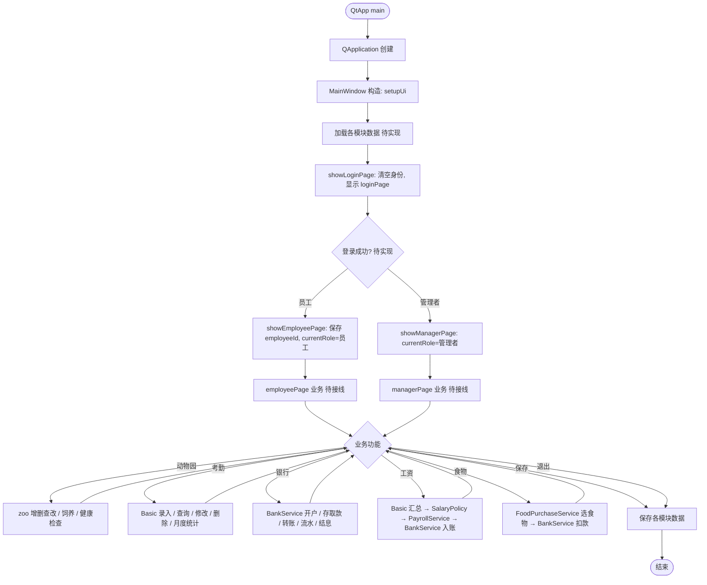

**说明：**

- 当前入口只创建 `QApplication` 和 `MainWindow`；`MainWindow` 构造函数只 `setupUi` + `showLoginPage`，不加载数据、不校验登录。图中的“加载数据”“登录成功”“业务页”都标了“待实现/待接线”，不是已跑通的功能。
- `MainWindow` 以成员对象组合 `zoo`、`Basic`、`FileOperation`、`BankService`、`PayrollService`、`FoodPurchaseService`，因此登录后的各页面共享同一份业务数据；切换页面只改 `currentEmployeeId`/`currentRole`，不重建服务对象。
- 动物园数据由 `zoo::load()/save()` 管理，文件是 `animals.txt` 和 `records.txt`。
- 考勤数据由 `FileOperation::Load()/Save()` 管理。
- 银行数据由 `BankService::loadData()/saveData()` 管理，底层是 `BankStorage` 的 CSV。
- 工资单由 `PayrollService::loadPayrolls()/savePayrolls()` 管理；食物目录由 `FoodPurchaseService::loadFoods()/saveFoods()` 管理。
- 合并前的银行 `MainMenu` 已有“登录 → 银行菜单”的框架，动物园 `main.cpp` 有“循环菜单 → 动物操作”的框架；两者都没有并入当前目录。当前 `QtApp/MainWindow` 是新写的 Qt 三页骨架（写：陈），后续可以把罗的 `MainMenu` 登录/菜单逻辑迁移进来（迁移部分写：罗，改：陈），把考勤、工资、食物入口补进同一个主界面。

### 3.2 动物园管理流程

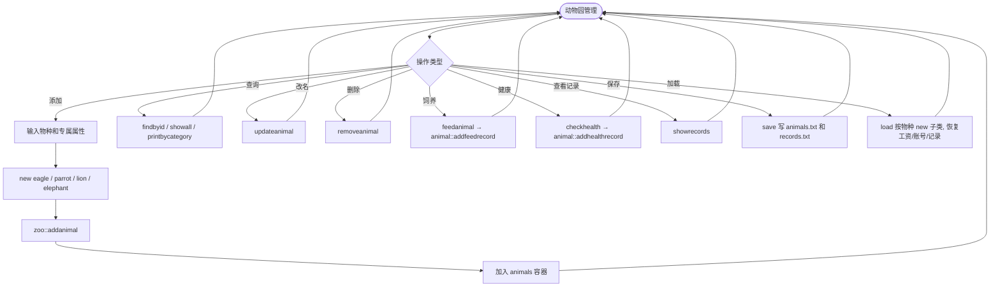

**现状提醒：**

- `addanimal()` 未检查编号重复，`removeanimal()` 未保护历史业务关联。
- `load()` 用 `stoll/stod` 解析工资和账号，字段缺失或格式错误时没有兜底。

### 3.3 考勤录入与月度统计流程

#### 3.3.1 录入一条考勤

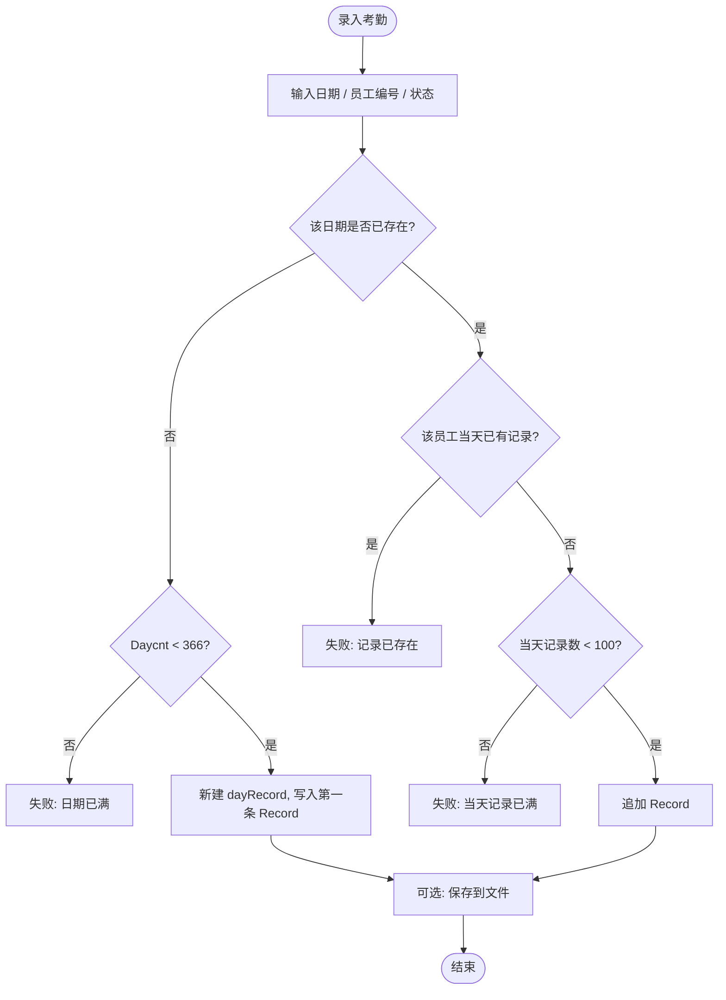

**现状提醒：** `Basic::addRecord()` 目前不检查员工是否存在于 `zoo`、不检查 `status` 是否在 0~2，失败只打印文字，不返回错误码。

#### 3.3.2 月度汇总 `Basic::summarize()`

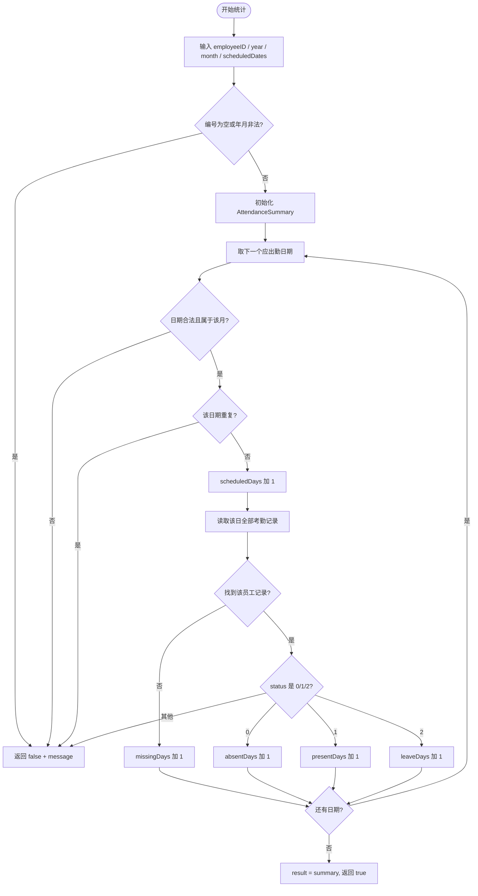

**结果含义：**

- `scheduledDays`：本月应出勤天数，由调用方传入排班日期；
- `presentDays/absentDays/leaveDays`：该员工在应出勤日期上的状态统计；
- `missingDays`：应出勤但没有任何记录的天数，不能算作缺勤；
- 统计成功的前提是：日期合法、属于该月、不重复、状态只取 0/1/2。

### 3.4 工资计算与发放流程

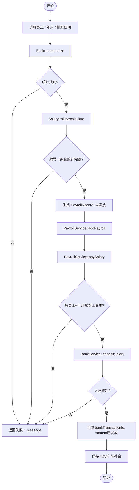

**关键校验（`SalaryPolicy::calculate()`）：**

- 员工编号必须与考勤统计一致；
- 出勤 + 缺勤 + 请假 + 未录入必须等于应出勤；
- 有未录入天数时拒绝计算；
- 实发工资 = 基本工资 − 缺勤天数 × 日扣款 − 请假天数 × 日扣款 + 奖金。

**现状提醒：**

- `PayrollService::paySalary()` 没有检查工资单是否已发放，重复调用可能重复入账；
- 发放成功后没有自动保存工资单，需要调用方再调 `savePayrolls()`；
- 实发为负、实发为 0 的情况还没有专门处理。

### 3.5 食物购买流程

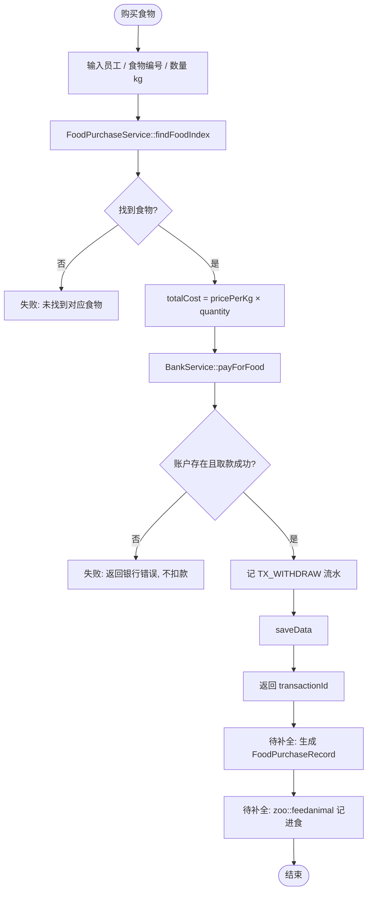

**现状提醒：**

- 当前 `purchaseFood()` 只计算总价并调用银行扣款，没有生成购买单，也没有写进食记录；
- 没有校验数量大于 0、单价非负、员工是否已绑定账号；
- `payForFood()` 记的是 `TX_WITHDRAW`，不是专门的“食物消费”类型；
- 保存失败时银行返回“内存已生效但保存失败”，调用方不能简单重试，否则可能重复扣款。

### 3.6 银行账户业务流程

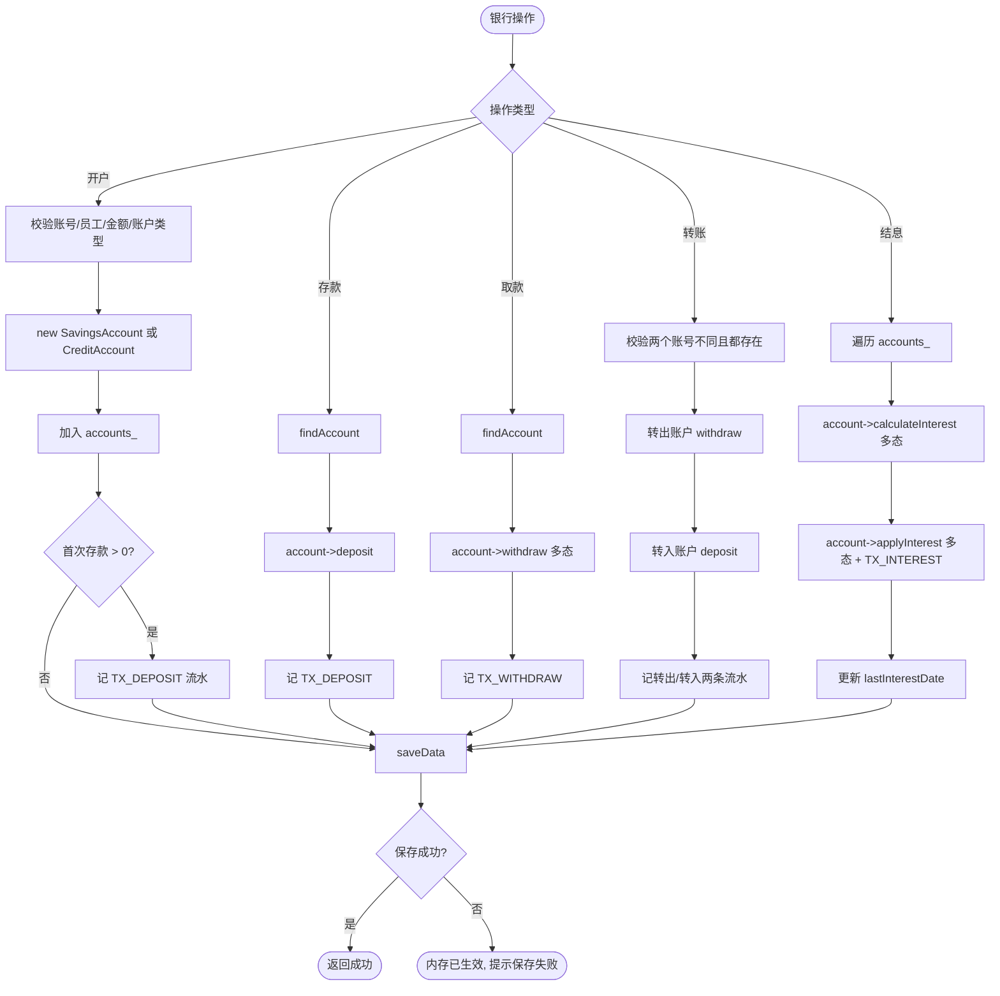

**多态说明：**

- 取款：储蓄账户检查最低留存余额，信用账户检查信用额度；
- 结息：储蓄账户利息入账，信用账户利息计入欠款；
- 保存：`BankStorage::saveAccounts()` 通过 `typeName()`、`minBalance()`、`creditLimit()` 取得派生类字段，不需要逐个判断类型。

### 3.7 数据持久化流程

| 模块 | 保存 | 加载 | 格式/注意点 |
| --- | --- | --- | --- |
| 动物园 | `zoo::save()` → `animals.txt`、`records.txt` | `zoo::load()` | `动物类型 → 编号 → 姓名 → 专属属性 → 工资 → 账号`；饲养/健康记录单独文件 |
| 考勤 | `FileOperation::Save()` | `FileOperation::Load()` | 每行 `年 月 日 编号 状态`，空格分隔 |
| 银行 | `BankService::saveData()` → `BankStorage` | `BankService::loadData()` | `accounts.csv`、`transactions.csv`，带表头，坏行跳过 |
| 工资 | `PayrollService::savePayrolls()` → `PayrollStorage::Save()` | `PayrollService::loadPayrolls()` → `PayrollStorage::Load()` | 空格分隔；先读临时 vector 再替换 |
| 食物 | `FoodPurchaseService::saveFoods()` → `FoodStorage::SaveFood()` | `FoodPurchaseService::loadFoods()` → `FoodStorage::LoadFood()` | 空格分隔；先读临时 vector 再替换 |

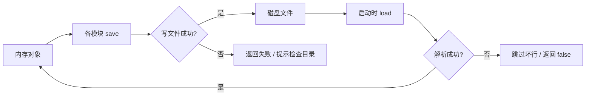

---

## 4. 现状、边界与待补全

| 位置 | 当前现状 | 影响 / 建议 |
| --- | --- | --- |
| 整合入口 | `QtApp/main.cpp` + `MainWindow` 已存在；构造只 `setupUi` + `showLoginPage`；`employeePage`/`managerPage` 为空 | 登录校验、数据加载/保存、业务按钮都待接线；当前只是界面骨架，不是完整程序 |
| `zoo::addanimal()` | 不检查编号重复；`animal*` 所有权约定只在注释里 | 重复编号会让考勤、账户、工资关联歧义；建议返回 `bool` 并明确失败时由调用方释放 |
| `zoo::removeanimal()` | 直接 `delete` | 有历史考勤/账户/工资时会断链；建议改为离职/停用，或先检查关联 |
| `zoo::save()/load()` | `saveline()` 已追加工资、账号；`load()` 用 `stoll/stod`，未校验字段数 | 旧格式或坏行可能越界/抛异常；建议先读临时容器、检查字段数和转换结果 |
| `feedrecord` | 只有日期和公斤数，没有食物编号、购买编号 | 无法防止重复进食记录；购买成功后回写进食记录待补 |
| `zoo` 中文字符串 | 部分字符已损坏为 `U+FFFD`，输出会乱码 | 不影响类结构；建议用 UTF-8 重新保存源文件 |
| `Basic::addRecord()` | 不校验员工存在、状态范围；返回 `void` | 非法数据可进入；建议改为返回 `bool` 并给出原因 |
| `Basic::deleteRecord()/changeRecord()` | 删除要求状态匹配；修改内部用 `cin`；未检查工资结算 | 界面与业务耦合；已发工资月份可能被改；建议参数化并加结算保护 |
| `Basic` 容量 | `day[366]`、每天 100 条 | 超过容量直接失败；多年数据需要换容器 |
| `FileOperation::Load()` | 边读边 `addRecord()` | 后面的坏行会让前面已读数据留在目标对象；建议临时对象全部成功后再替换 |
| `BankService::saveData()` | 账户、流水分别保存，不是原子操作；失败仍可能返回 `true` | 跨文件一致性风险；建议临时文件/事务日志，或统一快照 |
| `BankService::depositSalary()` | 按 `accountNo` 查找，`employeeId` 参数目前未参与归属校验；重复调用可重复入账 | 发薪前应校验 `ownerId == employeeId` 和工资单状态，最好用工资单号做幂等键 |
| `BankService::payForFood()` | 记 `TX_WITHDRAW`，没有食物消费类型；没有购买编号；保存失败返回 `true` | 流水无法按食物消费统计；建议增加 `TX_FOOD_PURCHASE` 和业务编号 |
| `BankService::openAccount()` | 不自动写 `Employee::bankAccountNo` | 开户后工资/购买可能找不到账户；由调用方绑定或服务内绑定 |
| `Transaction` | 枚举缺 `TX_FOOD_PURCHASE` | 食物消费只能混在取款里；按 `Transaction.h` 的 TODO 补 |
| `PayrollService::paySalary()` | 找到工资单后直接按传入 `record` 的金额入账；不检查是否已发放；成功后不自动保存 | 有重复发放风险；建议检查 `status`、从 `records[index]` 取金额，并在保存后再返回成功 |
| `SalaryPolicy::calculate()` | 固定每日扣款；不检查负工资 | 规则可配置性有限；负工资/零工资需要明确处理 |
| `FoodPurchaseService::purchaseFood()` | 不校验数量、价格、员工账号；不生成购买单；不调用 `zoo::feedanimal()` | 购买与进食未闭环；建议补 `FoodPurchaseRecord` 和进食关联 |
| `FoodPurchaseRecord` | 空结构体 | 购买单尚未落地；字段可参考 2.4.6 的建议 |
| `FoodStorage`/`PayrollStorage` | 空格分隔，字段不能含空格；不查重 | 格式脆弱；建议 CSV 或加转义/校验 |
| 命名 | `PayrollService.h` 守卫仍是 `APP_PAYROLLSERVICE_H`；`Basic`、`FileOperation` 名称偏泛 | 不影响编译；若最终统一改名，按“写：原作者，改：改名者”标注 |

---

## 5. 设计说明与答辩要点

1. **为什么让 `animal` 继承 `Employee`**：动物在本系统里同时是“动物园员工”，要参加考勤、领工资、开银行账户。把编号、姓名、基本工资、账号放在 `Employee`，四个模块共用一套身份，避免“动物一套编号、员工一套编号”对不上。
2. **为什么 `BankAccount` 不继承 `Employee`**：账户是员工拥有的资源，不是员工本身；一个员工可以有多个账户。用 `ownerId` 关联而不是继承，避免多重继承，也让银行账户规则可以独立复用。
3. **为什么金额用 `Money` 分**：`double` 累加会出现精度误差，账户余额、工资、食物扣款对不上账；统一用整数分，只在利息计算时临时转 `double`。
4. **为什么把 `Date` 放公共层**：银行的开户/结息/流水和考勤的按日记录都需要同一种日期；如果各模块各写一个 `Date`，比较、解析、格式化会不一致。统一后，考勤删除了自己的 `Date`，这是“统一接口导致的类名/来源改写”的典型例子。
5. **为什么工资单是快照**：工资发放后，考勤可能被补录或修改，基本工资也可能调整；如果工资单保存的是“实时引用”，历史工资就会变。`PayrollRecord` 保存 `AttendanceSummary` 和金额快照，已发放工资单不随之后的数据变化。
6. **为什么 `SalaryPolicy` 单独成类**：扣款规则会变（按天、按比例、奖金规则），把它从 `PayrollService` 和 `PayrollRecord` 中拆出来，便于替换和测试。
7. **多态的三个展示点**：动物园的 `display()/saveline()`、银行的 `withdraw()/calculateInterest()/applyInterest()`、存储层的 `typeName()/minBalance()/creditLimit()`；答辩时可以各举一个调用点。
8. **所有权与析构**：`zoo` 拥有 `animal*`，`BankService` 拥有 `BankAccount*`，两者都通过虚析构正确释放；新增对象时先决定“谁负责 delete”，避免泄漏或重复释放。
9. **当前完成度**：银行模块最完整；考勤的增删查改和月度统计已实现；工资、食物的类已落地但跨模块闭环（重复发放、购买单、进食记录、原子保存）还没完成；`QtApp/MainWindow` 的三页骨架已存在，但登录校验、数据加载/保存和业务按钮还未接线。报告中应区分“已实现”和“待补全”，不要把小标题当成人已经跑通的功能。

---

## 6. 附录

### 6.1 合并前文件到当前文件对照

| 合并前 | 当前 | 说明 |
| --- | --- | --- |
| `Project1/animal.h`、`animal.cpp` | `src/zoo/animal.h`、`animal.cpp` | 动物园继承体系；改继承 `Employee` |
| `Project1/zoo.h`、`zoo.cpp` | `src/zoo/zoo.h`、`zoo.cpp` | 动物园管理；改保存/加载 |
| `Project1/feedrecord.h` | `src/zoo/feedrecord.h` | 原样 |
| `Project1/healthrecord.h` | `src/zoo/healthrecord.h` | 原样 |
| `Project1/main.cpp` | 未并入 | 动物园菜单待整合 |
| `银行管理系统/src/common/Date.*` | `src/common/Date.*` | 增加 `operator==` |
| `银行管理系统/src/common/Money.*` | `src/common/Money.*` | 原样 |
| `银行管理系统/src/common/Employee.*` | `src/common/Employee.*` | 增加工资、账号 |
| `银行管理系统/src/bank/BankAccount.*` | `src/bank/BankAccount.*` | 原样 |
| `银行管理系统/src/bank/BankService.*` | `src/bank/BankService.*` | 增加 `payForFood`，改写 `depositSalary` |
| `银行管理系统/src/bank/BankStorage.*` | `src/bank/BankStorage.*` | 原样 |
| `银行管理系统/src/bank/Transaction.h` | `src/bank/Transaction.h` | 原样；食物类型待补 |
| `银行管理系统/src/app/MainMenu.*` | 未并入 | 银行界面层待整合 |
| `银行管理系统/src/app/PayrollService.*` | `src/payroll/PayrollService.*` | 迁移并重写 |
| `员工考勤系统/attendance/Record.h` | `src/attendance/Record.h` | 删除内部 `Date`，改用公共 `Date` |
| `员工考勤系统/attendance/Basic.*` | `src/attendance/Basic.*` | 增加 `summarize` |
| `员工考勤系统/attendance/FileOperation.*` | `src/attendance/FileOperation.*` | 适配公共 `Date` |
| 新增 | `src/attendance/AttendanceSummary.h` | 月度统计 |
| 新增 | `src/payroll/PayrollRecord.h`、`SalaryPolicy.*`、`PayrollStorage.*` | 工资单、规则、存储 |
| 新增 | `src/food/Food.*`、`FoodPurchaseRecord.h`、`FoodPurchaseService.*`、`FoodStorage.*` | 食物目录与购买 |
| 新增 | `QtApp/main.cpp`、`mainwindow.h`、`mainwindow.cpp`、`mainwindow.ui`、`CMakeLists.txt` | Qt 界面入口；当前只有登录/员工/管理者三页骨架，业务待接线 |

### 6.2 作者分工概览

| 作者 | 原稿/新增类型 | 说明 |
| --- | --- | --- |
| 邓 | `feedrecord`、`healthrecord`、`animal`、`bird`、`mammal`、`eagle`、`parrot`、`lion`、`elephant`、`zoo` | 动物园 10 个类型；`main.cpp` 菜单未并入 |
| 罗 | `Date`、`Money`、`Employee`、`BankAccount`、`SavingsAccount`、`CreditAccount`、`Transaction`、`BankService`、`BankStorage`、`MainMenu`、`PayrollService`（原稿） | 银行 6 个类 + 公共 3 个类型 + 银行界面 + 工资入账薄封装；`MainMenu` 未并入 |
| 陈 | `Record`、`dayRecord`、`Basic`、`AttendanceSummary`、`FileOperation`、`PayrollRecord`、`SalaryPolicy`、`PayrollStorage`、`Food`、`FoodPurchaseRecord`、`FoodPurchaseService`、`FoodStorage`、`MainWindow` | 考勤 5 个当前类型、工资 3 个新类型、食物 4 个类型、界面 1 个类型；另改写 `PayrollService`、`animal` 继承体系、`Employee`、`Date`、`BankService`、`zoo` 等 |

> 统计口径：`Money` 是类型别名，统计时按一个“类型”计；`MainMenu` 是合并前银行界面类，当前项目没有该文件；`QtApp/MainWindow` 是当前新增的界面类，`Ui::MainWindow` 由 Qt `uic` 生成，不计入手写类型；考勤原 `Date` 结构体已删除，未计入当前类型数。

### 6.3 一页速查

- **人员继承链**：`Employee` → `animal` → `bird`/`mammal` → `eagle`/`parrot`/`lion`/`elephant`
- **银行继承链**：`BankAccount` → `SavingsAccount`/`CreditAccount`
- **界面入口**：`QtApp/main.cpp` → `MainWindow` → `loginPage`/`employeePage`/`managerPage`
- **身份主键**：`Employee::id()`
- **账户主键**：`BankAccount::accountNo()`
- **工资单主键**：`employeeId + year + month`（`PayrollService::findPayrollIndex`）
- **考勤主键**：`date + employeeId`（`Basic::addRecord` 去重）
- **金额单位**：分（`Money`）
- **日期类型**：`common::Date`
- **已实现重点**：银行账户/存取款/转账/结息、考勤增删查改/月度统计、动物园继承体系/保存加载、工资计算、食物目录/扣款、Qt 三页框架与页面切换
- **待补全重点**：登录校验、员工/管理者页业务接线、数据加载/保存、工资重复发放保护、食物购买单/进食记录、银行跨文件原子保存、动物园删除保护、考勤结算保护

---

*本文只描述当前源码的类体系与作者归属；带“待补全”的条目是源码注释或现状分析，不代表已经实现。*
