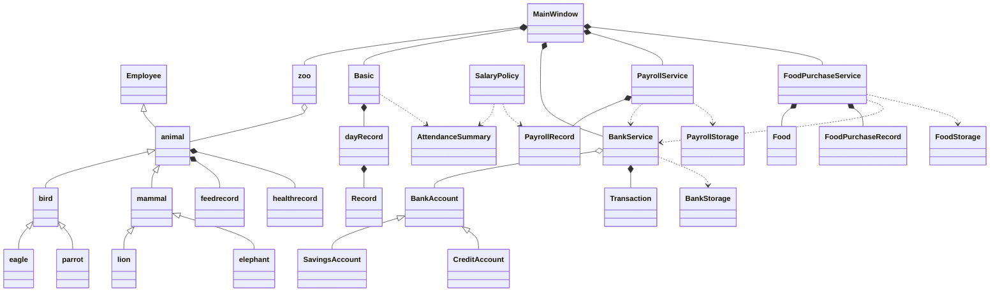
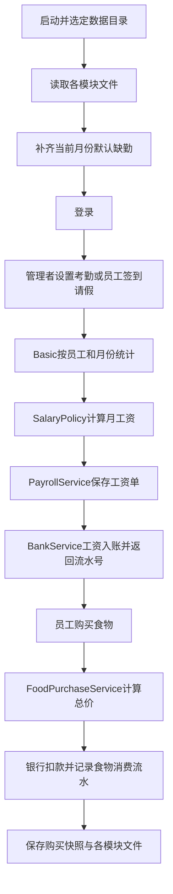

# 不疯狂动物城类说明

动物本身就是员工。员工的编号、姓名、基本工资和绑定账号保存在 `Employee` 中；动物子类增加物种资料。考勤、银行账户、工资单和食物购买通过员工编号关联，Qt 主窗口统一调用这些模块。数据使用文本和 CSV 文件保存。

本文覆盖当前项目的自定义类、结构体、公共类型和程序入口。类名保留源码写法，`animal`、`bird`、`mammal`、`zoo` 等不改名。

## 类体系和数据关联



继承只表达“是什么”：老鹰是一种鸟，鸟是一种动物员工。账户不是员工的子类；一个动物员工通过 `bankAccountNo` 绑定账户，账户通过 `ownerId` 保存员工编号。

`zoo` 负责释放加入集合的动物指针；`BankService` 负责释放账户指针。界面拿到的指针和集合引用用于查询、调用，不转移所有权。`PayrollRecord`、`AttendanceSummary` 和购买记录按值保存，形成当时的数据快照。

## 来源与分工

“bank”表示来源于 `银行管理系统.rar`；“zoo”表示来源于 `Project1(1).zip`；“考勤与整合”表示你的考勤开发和合并扩展。来源按原稿文件判断，不按现在所在文件夹判断。

| 来源 | 当前类型 | 整合后的主要变化 |
| --- | --- | --- |
| bank | `Employee`、`Date`、`Money` | 员工增加工资和绑定账号，日期统一供各模块使用 |
| bank | `BankAccount`、`SavingsAccount`、`CreditAccount` | 保留账户继承、取款和利息规则 |
| bank | `BankService`、`BankStorage`、`Transaction`、`TransactionType` | 增加食物付款、流水类型及界面查询接口 |
| bank | `PayrollService` | 原稿是工资入账接口，现增加月工资单集合、查重、发放状态和存储 |
| zoo | `animal`、`bird`、`mammal`、`eagle`、`parrot`、`lion`、`elephant` | `animal` 继承 `Employee`，复用统一编号、姓名、工资和账号 |
| zoo | `zoo`、`feedrecord`、`healthrecord` | 扩展员工公共字段读写，增加 Qt 查询接口 |
| 考勤与整合 | `Basic`、`Record`、`dayRecord`、`FileOperation` | 原考勤代码继续使用，补充统计、初始化、参数化修改和界面读取 |
| 考勤与整合 | `AttendanceSummary`、`PayrollRecord`、`SalaryPolicy`、`PayrollStorage` | 月度汇总、工资计算、工资单快照与保存 |
| 考勤与整合 | `Food`、`FoodPurchaseRecord`、`FoodPurchaseService`、`FoodStorage` | 食物目录、购买、银行扣款和购买快照 |
| 考勤与整合 | `MainWindow`、`ManagerUi`、`EmployeeUi` | 统一 Qt 界面、身份和数据对象 |

两个协作原始压缩包保持原样；独立的 `员工考勤系统/` 是历史快照，后续开发在本合并项目中进行。

## 公共类型

### Employee

文件：`src/common/Employee.h`、`Employee.cpp`。来源：bank，员工字段由考勤与整合扩展。

**功能**：保存所有动物员工共用的资料，作为动物继承树的基类。

- `id_`、`name_`：员工编号、姓名。
- `basicSalary_`：基本工资，单位分，初始为0。
- `bankAccountNo_`：绑定的工资及消费账号，允许暂时为空。
- 构造：`Employee()`、`Employee(id, name)`。
- 查询和修改：`id()`、`name()`、`basicSalary()`、`bankAccountNo()` 及对应 `setId()`、`setName()`、`setBasicSalary()`、`setBankAccountNo()`。
- `printInfo()` 提供控制台输出；析构函数为虚函数。

**实现思路**：编号和姓名只保存一份，动物不再另存同名字段。工资和账号通过 setter 设置，构造函数不负责开户或文件读写。基类虚析构使删除动物基类指针时能够正确析构派生对象。

### Date

文件：`src/common/Date.h`、`Date.cpp`。来源：bank。

**功能**：统一考勤日期、开户日期、交易日期和工资相关日期。

- 构造：默认日期为1970-01-01；三参数构造保存年、月、日。
- `year()`、`month()`、`day()`：读取日期分量。
- `isValid()`、`isLeapYear()`、`daysInMonth()`：校验年月日、计算闰年和月天数。
- `toString()`：输出 `YYYY-MM-DD`。
- `parse(text, result)`：读取用 `-` 或 `/` 分隔的日期，成功后才写入结果。
- `today()`：读取本机当前日期。
- `isBefore()`、`isSame()`、`operator==`：日期比较。
- `daysBetween(other)`：返回 `other - 当前日期` 的天数。

**实现思路**：比较和天数差通过私有 `toDayNumber()` 将日期换成累计天数。构造本身只赋值，需要检查时调用 `isValid()`；界面使用 `QDate` 选日期，再转换成业务层 `Date`。

### Money和金额函数

文件：`src/common/Money.h`、`Money.cpp`。来源：bank。`Money` 是 `long long` 类型别名，不是类。

**功能**：用整数分统一金额。`1000` 表示10.00元。

- `moneyToString(amount)`：把分转换为保留两位小数的元字符串，支持显示负数欠款。
- `parseMoney(text, cents)`：读取非负金额，支持最多两位小数，转换成分。

**实现思路**：日常工资、存取款、购买总价都使用整数运算，避免把元作为浮点数反复计算。银行利息在内部按利率计算后四舍五入到分。

## 动物员工模块

### animal

文件：`src/zoo/animal.h`、`animal.cpp`。来源：zoo，整合后继承 `Employee`。它是抽象类。

**功能**：表示动物员工，保存该动物的饲养和健康历史。

- `feedrecords`、`healthrecords`：属于该对象的两组记录。
- `getid()`、`getname()`、`setid()`、`setname()`：转调员工基类接口，不重复保存资料。
- `display()`、`getcategory()`、`getspecies()`、`saveline()`：由具体动物实现。
- `addfeedrecord()`、`addhealthrecord()`：添加记录。
- `getfeedrecords()`、`gethealthrecords()`：供界面读取。
- `saverecords()`：把记录转换成待保存的文本行。
- `showrecords()`：控制台显示历史。

**实现思路**：共用的员工字段放在 `Employee`，共用的动物历史放在 `animal`，物种专有字段交给派生类。Qt 表格调用 getter，文件保存调用虚函数，形成同一对象在不同模块中的统一身份。

### bird

文件：`src/zoo/animal.h`、`animal.cpp`。来源：zoo。继承 `animal`，仍为抽象类。

**功能**：保存鸟类共有的翼展 `winglength`，提供 `getwinglength()`；`getcategory()` 返回鸟类。

**实现思路**：构造时先调用 `animal(id, name)`，再初始化翼展。老鹰、鹦鹉复用这一个字段，不各自重复声明。

### mammal

文件：`src/zoo/animal.h`、`animal.cpp`。来源：zoo。继承 `animal`，仍为抽象类。

**功能**：保存哺乳动物的食性 `dietType`，提供 `getdiettype()`；`getcategory()` 返回哺乳动物。

**实现思路**：构造时把编号、姓名交给动物基类，自身保存食性。食性用于资料展示，不对食物购买增加限制。

### eagle

文件：`src/zoo/animal.h`、`animal.cpp`。来源：zoo。继承 `bird`。

**功能**：表示老鹰员工。构造接收编号、姓名、翼展；实现 `display()`、`getspecies()`、`saveline()`。

**实现思路**：`getspecies()` 返回存储标识 `eagle`；保存编号、姓名、翼展、基本工资和账号，其他资料从基类读取。

### parrot

文件：`src/zoo/animal.h`、`animal.cpp`。来源：zoo。继承 `bird`。

**功能**：表示鹦鹉员工，接口与老鹰相同。

**实现思路**：共享 `bird` 的翼展和员工继承链，存储标识使用 `parrot`，加载时据此创建正确子类。

### lion

文件：`src/zoo/animal.h`、`animal.cpp`。来源：zoo。继承 `mammal`。

**功能**：表示狮子员工，构造接收编号、姓名，食性设为肉食。

**实现思路**：通过 `mammal` 初始化食性，通过 `Employee` 保存员工资料；`getspecies()` 返回 `lion`，保存行不包含翼展。

### elephant

文件：`src/zoo/animal.h`、`animal.cpp`。来源：zoo。继承 `mammal`。

**功能**：表示大象员工，构造接收编号、姓名，食性设为草食。

**实现思路**：与狮子共用哺乳动物基类，存储标识为 `elephant`，不为工资、考勤或账户另外建立大象专属类。

### feedrecord

文件：`src/zoo/feedrecord.h`。来源：zoo。它是结构体。

**功能**：保存一次饲养的 `date` 和 `amount`，数量单位kg。

**实现思路**：作为 `animal` 内部记录保存，所属动物由所在对象确定。食物购买不会自动创建这条记录，管理者单独登记饲养。

### healthrecord

文件：`src/zoo/healthrecord.h`。来源：zoo。它是结构体。

**功能**：保存健康检查的 `date`、`status`、`note`。

**实现思路**：记录本身只保存数据，归属由动物对象确定。界面输入日期和状态后，通过 `zoo::checkhealth()` 找到动物并追加记录。

### zoo

文件：`src/zoo/zoo.h`、`zoo.cpp`。来源：zoo。

**功能**：统一管理动物员工对象，维护 `vector<animal*> animals`。

| 接口 | 作用 |
| --- | --- |
| `addanimal()`、`findbyid()`、`removeanimal()` | 添加、按编号查找、删除动物员工 |
| `updateanimal()` | 修改姓名 |
| `count()`、`getanimals()` | 返回数量、读取集合 |
| `feedanimal()`、`checkhealth()` | 按编号给动物追加饲养、健康记录 |
| `save()`、`load()` | 保存和读取员工及历史记录 |
| `clear()`、析构函数 | 释放集合拥有的动物对象 |
| `showall()`、`printbycategory()`、`showrecords()` | 保留原动物园控制台查询接口 |

**实现思路**：用基类指针保存不同动物，按物种文本创建具体子类。`load()` 在成功打开动物文件后清空旧集合，避免重复加载时追加重复对象；析构复用 `clear()`。

保存采用统一新格式：鸟类6列，哺乳类5列。编号、姓名后的字段依物种确定，最后两列都是基本工资和绑定账号。记录另外保存在 `records.txt`。

## 考勤模块

### Record

文件：`src/attendance/Record.h`。来源：考勤与整合。它是结构体。

**功能**：保存某员工当天的 `ID` 和 `status`：0缺勤、1出勤、2请假。

**实现思路**：日期由外层 `dayRecord` 保存，单条员工记录不重复保存日期。默认构造用于创建数组元素；有参构造用于写入实际记录。默认状态为0不等于已经登记，还要更新所在数组的有效记录数。

### dayRecord

文件：`src/attendance/Record.h`。来源：考勤与整合。它是结构体。

**功能**：保存一个日期 `date`、当天最多100条 `dayrecords` 和有效条数 `Recordcnt`。

**实现思路**：按日期组织员工记录；`Recordcnt` 从0开始，仅遍历已使用的数组元素，不把数组空位置当成员工缺勤。

### Basic

文件：`src/attendance/Basic.h`、`Basic.cpp`。来源：考勤与整合。

**功能**：考勤增删查改、月度统计和默认缺勤初始化。

| 接口 | 作用与实现思路 |
| --- | --- |
| `Basic()` | 将有效日期数 `Daycnt` 初始化为0 |
| `addRecord(date, ID, status)` | 找日期组；没有就新建；同一天同一员工已有记录则不重复添加 |
| `changeRecord(date, ID, newStatus)` | 找到记录后修改状态，返回是否找到并修改成功；不从 `cin` 读取输入 |
| `deleteRecord(date, ID, status)` | 日期、编号、状态匹配后删除，并将后面的元素前移 |
| 三个 `searchRecord()` 重载 | 控制台按日期与编号、日期、编号查询 |
| `getRecord(date, result[])` | 复制当天有效记录并返回条数，调用方提供 `MAX_RECORDS` 容量的数组 |
| `dayCount()`、`dayAt(index)` | Qt 遍历日期组；越界的 `dayAt()` 返回空指针 |
| `initialize(ID, scheduledDates)` | 对应出勤日期逐个检查，缺记录才调用 `addRecord(..., 0)`，保留已有出勤和请假 |
| `summarize(...)` | 只统计指定员工、指定月份的应出勤日期，成功时返回 `AttendanceSummary` |

**实现思路**：内部仍使用原考勤的定长数组 `day[MAX_DAYS]`。先定位日期，再定位员工；月度统计读取当日记录，按状态累加。统计结果先放在局部变量中，检查通过后再赋给输出参数。

容量是累计最多366个不同日期、每天100个员工，不是每年自动清空。`FileOperation` 是友元，负责读取有效数组内容并持久化。

### AttendanceSummary

文件：`src/attendance/AttendanceSummary.h`。来源：考勤与整合。它是结构体。

**功能**：保存员工编号、年、月、应出勤、出勤、缺勤、请假和未录入天数。

**实现思路**：它是统计结果，不管理原始记录。初始化会创建实际缺勤记录；仍没有找到的应出勤记录计入 `missingDays`，用于识别未补齐或容量不足。该结构也被复制到工资单中保存计算依据。

### FileOperation

文件：`src/attendance/FileOperation.h`、`FileOperation.cpp`。来源：考勤与整合。

**功能**：`Save(basic, filename)` 保存考勤；`Load(basic, filename)` 读取考勤。

**实现思路**：每行写入年、月、日、员工编号、状态。加载时先写入局部 `Basic loaded`，完整读取成功后才替换原对象；重复加载会恢复文件内容，不再把旧内存记录留在前面。

## 银行模块

### BankAccount

文件：`src/bank/BankAccount.h`、`BankAccount.cpp`。来源：bank。它是抽象类。

**功能**：保存账号、户主编号、户主姓名快照、余额、开户日期、上次结息日期。

- 读取：`accountNo()`、`ownerId()`、`ownerName()`、`balance()`、`openDate()`、`lastInterestDate()`。
- `deposit()`：增加余额；本方法本身不生成银行流水。
- `withdraw()`、`typeName()`、`calculateInterest()`：由具体账户实现。
- `applyInterest()`：储蓄默认按存入处理，信用账户覆盖此规则。
- `minBalance()`、`creditLimit()`：提供不同账户参数的统一查询接口。
- `setLastInterestDate()`、`takeAllBalanceForClose()`：更新结息日期、销户时取走余额。
- `printInfo()`：控制台显示账户；析构函数为虚函数。

**实现思路**：所有账户有共同字段，但取款和计息规则不同，因此由派生类覆盖虚函数。账户通过员工编号关联动物，不继承 `Employee`。

### SavingsAccount

文件：`src/bank/BankAccount.h`、`BankAccount.cpp`。来源：bank。继承 `BankAccount`。

**功能**：储蓄账户，增加最低留存余额 `minBalance_`。

**实现思路**：取款后余额必须不低于最低留存金额。利息按代码中的年利率0.015计算：当前余额 × 年利率 × 天数 ÷ 365，四舍五入到分。利息存入账户。构造函数把公共字段交给 `BankAccount` 初始化。

### CreditAccount

文件：`src/bank/BankAccount.h`、`BankAccount.cpp`。来源：bank。继承 `BankAccount`。

**功能**：信用账户，增加信用额度 `creditLimit_`，允许余额为负。

**实现思路**：取款后的余额不能低于负信用额度。只有存在欠款时计算利息，按代码中的日利率0.0005乘欠款和天数；利息从余额扣除，使欠款增加。`applyInterest()` 覆盖了基类的存入规则。

银行计息沿用原稿的简化方式，按当前余额与日期间隔计算，不重放每天的历史余额。

### Transaction

文件：`src/bank/Transaction.h`。来源：bank，食物消费类型由整合扩展。

**功能**：保存流水号、账号、交易类型、金额、交易后余额、交易日期和备注。

**主要接口**：构造函数、`id()`、`accountNo()`、`type()`、`amount()`、`balanceAfter()`、`date()`、`note()`、`typeName()`、`typeFromName()`。

**实现思路**：流水是发生交易时的快照，不参与账户继承。显示与文件解析通过类型名称互转；实现放在头文件内，使用 `inline` 避免多重定义。

### TransactionType

文件：`src/bank/Transaction.h`。这是银行已有的交易类型枚举，不是类。

当前值对应存款、取款、转入、转出、工资入账、利息和食物消费。它只分类交易，不表示员工身份或动物物种；不需要为每个物种创建一种交易类型。

### BankService

文件：`src/bank/BankService.h`、`BankService.cpp`。来源：bank。

**功能**：拥有账户集合、流水集合和下一个流水号，统一处理资金交易。

| 接口 | 作用 |
| --- | --- |
| `openAccount()` | 按账户类型创建储蓄或信用对象；有首次存款时生成存款流水 |
| `closeAccount()` | 拒绝带欠款销户；取走剩余余额、记录流水并删除账户 |
| `findAccount()`、`findFirstAccountByOwner()` | 按账号、户主编号查找 |
| `getAccounts()`、`getTransactions()` | 给 Qt 读取集合，不转移对象所有权 |
| `deposit()`、`withdraw()`、`transfer()` | 修改余额并生成相应流水；转账产生转出、转入两条 |
| `depositSalary()` | 核对账户户主，存入工资，返回工资流水号 |
| `payForFood()` | 调用账户的取款规则，生成食物消费流水并返回编号 |
| `settleInterest()` | 调用不同账户的计息、入息规则，更新上次结息日期 |
| `loadData()`、`saveData()` | 委托 `BankStorage` 读写账户和流水 |
| `printAllAccounts()`、`printAccountsByOwner()`、`printTransactions()`、`printTransactionsByDate()` | 保留原银行控制台查询能力 |

**实现思路**：`vector<BankAccount*>` 保存不同账户，调用虚函数处理差异；`addTransaction()` 统一分配编号、记录余额和日期。加载后扫描最大流水号，下次从最大值加1开始，避免重新从1编号。银行服务禁止复制，防止原始指针集合被浅拷贝后重复释放。

银行保存失败时，部分资金操作会返回“内存已生效但文件保存失败”的提示，界面保留该提示，不能把这种情况当成尚未扣款而重复操作。账户、流水及上层记录分文件保存，并不是跨文件事务。

### BankStorage

文件：`src/bank/BankStorage.h`、`BankStorage.cpp`。来源：bank。

**功能**：读写 `accounts.csv` 和 `transactions.csv`，负责路径、拆分、转换和格式检查。

**主要接口**：构造函数、`setDataDir()`、`dataDir()`、`accountsFilePath()`、`transactionsFilePath()`、`loadAccounts()`、`saveAccounts()`、`loadTransactions()`、`saveTransactions()`。

**实现思路**：按逗号拆分行，跳过表头，把金额读成分、日期读成 `Date`。读取账户时按类型创建派生对象，保存时通过统一 getter 输出。交易备注中的逗号、换行由银行服务预先清理。

## 工资模块

### PayrollRecord

文件：`src/payroll/PayrollRecord.h`。来源：考勤与整合。

**功能**：保存一张月工资单。

- 身份与月份：`payrollId`、`employeeId`、`year`、`month`、`accountNo`。
- 计算依据：`attendance`、`basicSalary`、`absentDeduction`、`leaveDeduction`、`bonus`、`finalsalary`。
- 发放结果：`status`、`bankTransactionId`。

**实现思路**：把计算时的考勤统计和金额复制进工资单，历史工资不随员工后来改名、调整基本工资或更正考勤而自动变化。未发放时流水号为0，真正发放成功后记录银行返回的编号。

### SalaryPolicy

文件：`src/payroll/SalaryPolicy.h`、`SalaryPolicy.cpp`。来源：考勤与整合。

**功能**：保存每次缺勤扣款、每次请假扣款和奖金，`calculate()` 生成工资单结果。

**实现思路**：检查员工编号一致、统计天数相加等于应出勤、没有未录入，再计算：

```text
缺勤扣款 = 缺勤天数 × 每次缺勤扣款
请假扣款 = 请假天数 × 每次请假扣款
实发工资 = 基本工资 − 缺勤扣款 − 请假扣款 + 奖金
```

工资单编号采用“员工编号-年-月”。本类只计算，不向银行存款；月份结束判断由 Qt 工资入口处理。当前计算不把负工资自动改为0，演示和正常操作中应设置合适的工资及扣款金额。

### PayrollService

文件：`src/payroll/PayrollService.h`、`PayrollService.cpp`。来源：bank 原工资接口，考勤与整合扩展。

**功能**：管理工资单集合和发放状态，连接工资计算与银行入账。

- `addPayroll()`：同一员工同一年月不能重复添加。
- `findPayrollIndex()`：按员工、年份、月份找集合下标。
- `getPayrollRecords()`：供界面读取工资单。
- `paySalary()`：按集合中已保存的工资单发放，拒绝重复发放。
- `savePayrolls()`、`loadPayrolls()`：调用 `PayrollStorage`。

**实现思路**：计算结果先加入集合；发放时读取集合里的账号和金额，调用 `BankService::depositSalary()`，成功后把状态改成“已发放”并回填流水号。界面筛选后的行号不等于集合下标，因此先按工资单编号找回记录再发放。

### PayrollStorage

文件：`src/payroll/PayrollStorage.h`、`PayrollStorage.cpp`。来源：考勤与整合。

**功能**：`Save()`、`Load()` 保存或恢复工资单集合。

**实现思路**：每行20个空格分隔字段，包含工资信息和考勤快照。读取时先放入临时 `vector<PayrollRecord>`，全部读取成功后替换，避免重复追加和半份覆盖。

## 食物模块

### Food

文件：`src/food/Food.h`、`Food.cpp`。来源：考勤与整合。

**功能**：保存食物编号、名称、每公斤价格，价格单位分/kg。

**主要接口**：默认和三参数构造；`getFoodId()`、`getFoodName()`、`getPricePerKg()`、`setFoodPrice()`。

**实现思路**：食物只描述目录中的商品，不保存员工余额或饲养量；购买时由服务根据单价和整数公斤数计算总价。

### FoodPurchaseRecord

文件：`src/food/FoodPurchaseRecord.h`。来源：考勤与整合。它是结构体。

**功能**：保存成功购买时的购买单编号、员工编号、食物编号及名称、数量、单价、总价、账号、日期、状态和银行流水号。

**实现思路**：它保存商品和购买情况的快照，银行仍是资金流水的唯一业务来源。快照可解释“买了什么、多少公斤、当时多少钱”，银行流水解释“哪个账户扣了多少钱”；两者通过 `bankTransactionId` 对应，不重复执行扣款。

### FoodPurchaseService

文件：`src/food/FoodPurchaseService.h`、`FoodPurchaseService.cpp`。来源：考勤与整合。

**功能**：维护食物目录和购买记录，调用银行完成支付。

- `addFood()`、`findFoodIndex()`、`getFoods()`：添加、定位、读取食物，拒绝重复编号。
- `purchaseFood()`：计算总价，调用银行扣款，返回流水号。
- `getPurchaseRecords()`：读取购买快照。
- `saveFoods()`、`loadFoods()`、`savePurchases()`、`loadPurchases()`：委托存储类。

**实现思路**：先确认绑定账户属于该员工，再查食物、计算 `单价 × 数量`，调用 `BankService::payForFood()`。支付成功才追加购买快照；失败不追加。购买单编号由集合生成并检查唯一性。Qt 只在员工端提供购买入口，管理者只维护目录和查询。

### FoodStorage

文件：`src/food/FoodStorage.h`、`FoodStorage.cpp`。来源：考勤与整合。

**功能**：`SaveFood()`、`LoadFood()` 读写食物目录；`SavePurchases()`、`LoadPurchases()` 读写购买快照。

**实现思路**：目录采用空格分隔的编号、名称、单价；购买记录采用11列竖线分隔格式。读取都先建立临时集合，完成后替换。目录名称不含空格，记录文本不含竖线。

## Qt界面和入口

### MainWindow

文件：`QtApp/mainwindow.h`、`mainwindow.cpp`、`managerpage.cpp`、`employeepage.cpp`。来源：考勤与整合。继承 Qt 的 `QMainWindow`。

**功能**：拥有各模块的一份业务对象，统一登录、页面、弹窗、数据保存和刷新。

| 职责 | 主要函数 |
| --- | --- |
| 窗口与身份 | 构造、析构、`closeEvent()`、`handleLogin()`、`logout()`、`showLoginPage()`、`showManagerPage()`、`showEmployeePage()` |
| 页面创建 | `setupLoginPage()`、`setupManagerPage()`、`setupEmployeePage()`、各个 `create...Tab()` |
| 数据与排班 | `loadAllData()`、`saveAllData()`、`initializeAttendance()`、`buildScheduledDates()` |
| 管理者考勤 | `changeAttendance()` 设置或补录、`deleteAttendance()`、`summarizeAttendance()` |
| 员工操作 | `employeeSignIn()`、`employeeRequestLeave()`、`employeeSummarizeAttendance()`、`employeeDeposit()`、`employeeWithdraw()`、`employeePurchaseFood()` |
| 员工与动物 | `addAnimal()`、`updateAnimalInfo()`、`deleteAnimal()`、`addFeedRecord()`、`addHealthRecord()`、`showAnimalRecords()` |
| 银行 | `openBankAccount()`、`closeBankAccount()`、`depositMoney()`、`withdrawMoney()`、`transferMoney()`、`settleInterest()`、`filterBankTransactions()` |
| 工资与食物 | `generatePayroll()`、`paySelectedPayroll()`、`addFood()` |
| 统一刷新 | `refreshAll()`、`refreshManagerUi()`、`refreshEmployeeUi()`、`refreshWorkTables()`、各个 `refresh...()`、`fillEmployeeCombos()`、`fillFoodCombos()` |
| 控件与定位 | `newTable()`、`newButton()`、`newLine()`、`newHint()`、`newGroup()`、`newDialog()`、`dialogAction()`、`newDataButton()`、`closeOperationDialog()`、`selectedAnimal()`、`selectedAccount()`、`selectZooRow()`、`onZooSelectionChanged()` |
| 输入与提示 | `readMoney()`、`readDate()`、`dateFromQDate()`、`statusText()`、`showInfo()`、`showError()`、`showStatus()` |

**实现思路**：`QStackedWidget` 保留登录、管理者、员工三个身份页面；管理者四页、员工三页。主页面只保留表格和常用按钮，表单使用同一窗口持有的 `QDialog`。成功才关闭输入弹窗，失败时保留输入。

管理者设置考勤时，先尝试 `changeRecord()`；记录不存在才 `addRecord()`，保存后同步主页面的员工和月份。员工签到和请假只修改自己的默认记录。员工数据查询都使用 `currentEmployeeId`，不让员工手填别人的编号。

`initializeAttendance()` 为所有员工补齐指定月份的周一至周五记录；`buildScheduledDates()` 是三个考勤、工资入口共同使用的排班来源。工资生成、发放入口只允许已结束的月份。

### ManagerUi

文件：`QtApp/mainwindow.h`，是 `MainWindow` 内部结构体。来源：考勤与整合。

**功能**：集中保存管理者页面、输入弹窗、表格和共享选择器的控件指针。

**实现思路**：只保存界面引用，不另存员工、账户、工资等业务副本。考勤设置表单有自己的员工、日期和状态输入；主页面的员工、年、月由考勤与工资共用。

### EmployeeUi

文件：`QtApp/mainwindow.h`，是 `MainWindow` 内部结构体。来源：考勤与整合。

**功能**：保存员工工作台、钱包、食物购买所需控件指针。

**实现思路**：余额、账户、流水、工资和购买记录从共享业务对象读取，再按当前员工编号过滤。存款、取款共用账户、业务类型和金额表单，避免重复摆放两套输入框。

### Ui::MainWindow和main入口

`Ui::MainWindow` 由 `mainwindow.ui` 经 Qt 工具生成，保存三个身份页面和堆叠控件，不是另一个手写业务窗口。实际控件主要由上述 Qt 源文件创建。

`QtApp/main.cpp` 只有统一的应用入口：创建 `QApplication`，设置字体和样式，选定数据目录，再创建 `MainWindow`。默认使用“文档/不疯狂动物城数据”；传入 `--data-dir` 时使用指定目录。演示脚本利用这个参数隔离正式数据和演示数据，不增加第二个程序入口。

## 构造与调用流程

```text
创建 eagle(id, name, wing)
→ Employee 保存编号姓名，工资初始0、账号为空
→ animal 初始化动物记录集合
→ bird 保存翼展
→ eagle 完成物种对象构造
→ setter 设置基本工资
→ zoo 接管指针
→ BankService 根据同一员工身份开户
→ 动物绑定账户号
```



工资计算、银行入账、购买支付是顺序调用的独立步骤；饲养和健康另行登记。旧控制台查询接口保留在业务类中用于原模块复用，Qt 展示使用 getter，不通过捕获 `cout` 生成界面。
